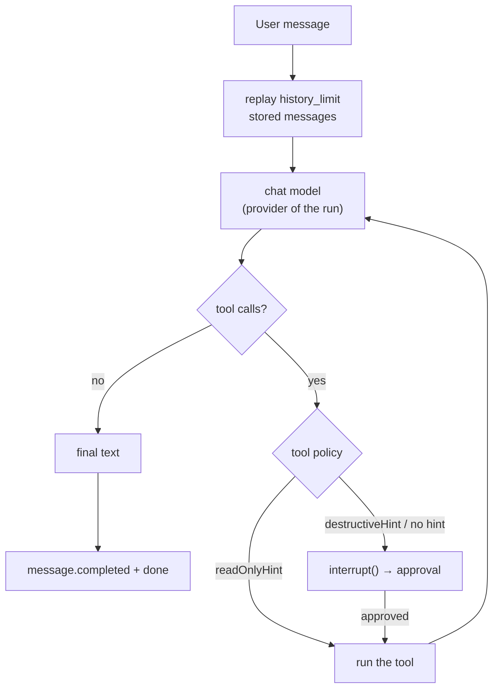
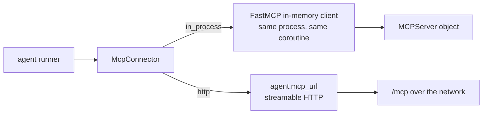

# Agent runtime

How a prompt becomes a streamed answer: the graph loop, the transports, the
checkpoints and the budgets that stop a run.

*Diátaxis type: explanation* · **Audience:** contributors · **Prerequisites:** [Architecture](architecture.md)

**On this page**

- [What the runtime is not](#what-the-runtime-is-not)
- [The graph loop](#the-graph-loop)
- [Two transports](#two-transports)
- [Checkpoints and steering](#checkpoints-and-steering)
- [Budgets and run statuses](#budgets-and-run-statuses)
- [Observability](#observability)

## What the runtime is not

`etlalchemy/agent/` holds no state and owns no table. It is injected with the
ports it needs, which is why it can be reasoned about in one sitting.

| Package | Role |
|---|---|
| `llm_config/` | context: `LlmProvider` aggregate, credential, visibility |
| `conversation/` | context: `Conversation` with `Message`, `Run`, `Approval` |
| `agent/` | runtime: MCP client, tool adapter, graph, policy, SSE |

Both contexts follow the repository conventions (one aggregate module, one view,
`<context>_<plural>` tables, `<context>_application`, `<context>_projection`).

## The graph loop

*Figure 1: A hand-built `StateGraph` (`add_messages` + `ToolNode` + a conditional edge) — `create_react_agent` is deprecated and fails this project's warnings-as-errors gate.*

The answer recorded for a turn comes **only from the current turn**: the replayed
history sits in front of it, and a provider that spends its whole budget thinking
produces an empty message, which is nudged up to `MAX_EMPTY_TURNS` times before
the run records `(the model finished without an answer)`.

## Two transports

*Figure 2: Either way the runner only sees MCP primitives; the difference is whether a socket sits in between.*

`in_process` is the default: the container owns one `MCPServer` and the connector
hands FastMCP its own in-memory client, so a tool call goes through the same
packages, annotations, logging middleware and permission checks an HTTP call
would — with no port, handshake or proxy in the middle.

Authentication does not weaken: the streaming route already verified the token,
so the connector binds the session id in a contextvar and `current_session_id()`
reads it exactly like a token claim. A call with neither a bound session nor a
token fails closed with `invalid or expired token`.

The `http` transport sets `trust_env=False`: its endpoint is this process's own
server, and an `ALL_PROXY` in the container would otherwise push the internal
call through a proxy that cannot reach it. The LLM clients do the opposite on
purpose, so a corporate proxy still works for model traffic.

## Checkpoints and steering

Every run owns its checkpoint thread, `<conversation_id>:<run_id>`. A new prompt
therefore never inherits a half-finished graph state, while a resume reuses the
thread of the run it continues — which is what makes an approval survive a
restart or arrive from another replica.

`sqlite` uses `AsyncSqliteSaver`, `postgres` uses `AsyncPostgresSaver`. Those two
tables, `checkpoints` and `checkpoint_writes`, are the one documented exception to
the `<context>_<plural>` naming rule.

**Steering a run in flight is not supported.** One conversation owns one active
run, so a second message is rejected with `409` until the first finishes or
`run_stale_after_seconds` expires.

## Budgets and run statuses

| Limit | Behaviour when exceeded |
|---|---|
| `max_tool_calls` | counts **starts**, so concurrent calls consume budget |
| `token_budget` | enforced on the usage the provider reports |
| `max_wall_clock_seconds` | the run is persisted as `interrupted`, not `failed` |
| `tool_timeout_seconds` | the call returns `[timeout] …` as a *result* |

A failed tool call is a result, not an exception: a timeout, an unreachable
endpoint or a failing resource read comes back to the model as bracketed text so
the loop continues. Only the budgets and the approval `interrupt` end a run.

## Observability

`agent.observability.mlflow.enabled` wraps every run in `trace_run` and records
`tool_calls`, `tokens` and the final status. With tracing off, MLflow is never
imported, so the extra stays optional.

The runtime also logs through the shared facade: `agent.approval.replayed` when a
resume re-asks an already-decided card, and one `request` line per streamed
response from the HTTP middleware.

## FAQ

**Why not `langchain-mcp-adapters`?** Its 0.3.x line needs `mcp` 1.x and
downgrades the pinned 2.x, which breaks the MCP test suite. The runtime uses the
`mcp` SDK directly.

**Can two runs share a conversation?** No — that is what the `409` prevents.

**What is still open?** Steering has no endpoint, by decision.

## See also

- [Agent tools](agent-tools.md) — policy, approvals, redaction
- [SSE events](../reference/sse-events.md) — what the client receives
- [Use the agent](../guides/use-the-agent.md) — the flow by hand
