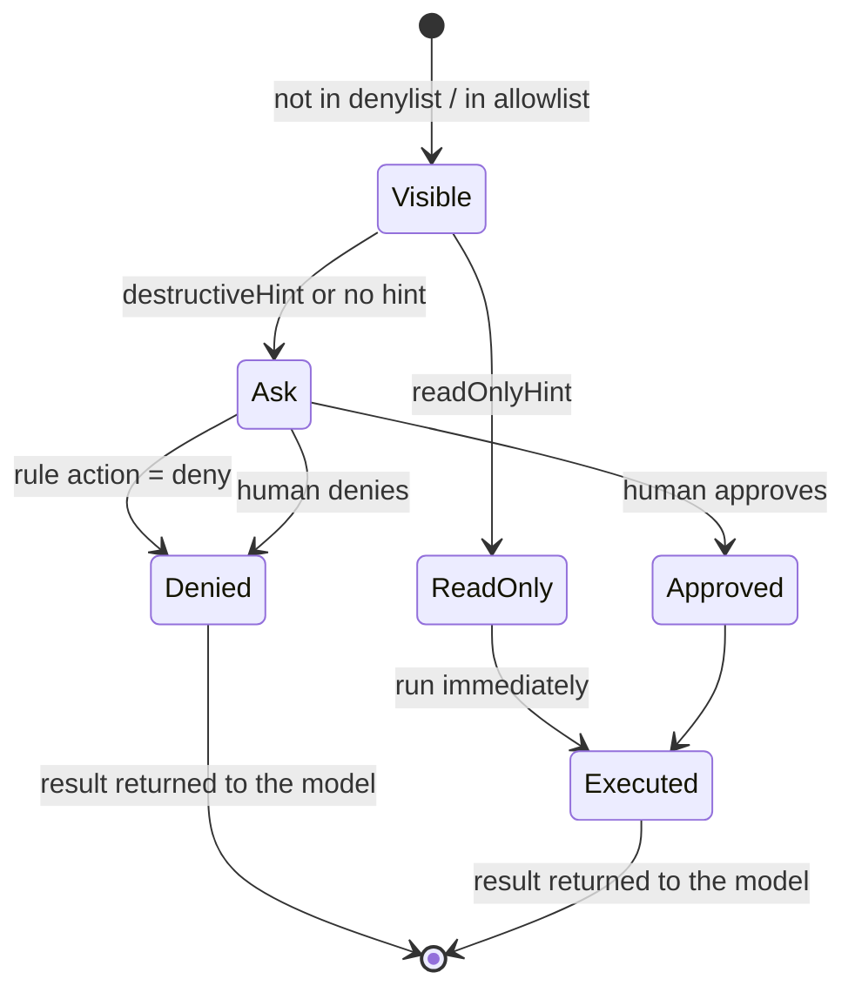

# Agent tools

How the model is allowed to touch your metadata: which tools it sees, which run
unattended, which pause for a human, and what reaches the browser.

*Diátaxis type: explanation* · **Audience:** contributors · **Prerequisites:** [MCP surface](../reference/mcp-surface.md)

**On this page**

- [The policy decision](#the-policy-decision)
- [One approval at a time](#one-approval-at-a-time)
- [Auto-approve](#auto-approve)
- [Resource reads](#resource-reads)
- [Redaction and previews](#redaction-and-previews)
- [Object URNs](#object-urns)

## The policy decision

*Figure 1: Four inputs decide one call — the list filters, the annotation, the first matching rule and, last, the human.*

| Situation | Outcome |
|---|---|
| tool in `agent.tools.denylist` | not visible to the model at all |
| `allowlist` set and tool missing from it | not visible |
| `readOnlyHint` | runs immediately |
| `destructiveHint` | first matching `approval.rules` entry, else `approval.default` (`deny`) |
| **no hint at all** | an approval is required — an unannotated tool is not trusted |

A rule beats the fallback in both directions: a `deny` rule refuses even a
`destructiveHint` tool, and a `require_approval` rule asks even when the default
is `deny`.

## One approval at a time

LangGraph resumes a task's pending interrupts with a single value and matches it
to the interrupt calls of that task **by position**. A model that asks for two
destructive calls in one step would make `Command(resume=…)` ambiguous.

The asks are therefore serialised with a lock: the step pauses on the first call
and the second asks on the resume that answers it. Nothing is refused on the
user's behalf, and the client always shows exactly one pending card.

An approval id is derived from `(run_id, tool, args_hash)` plus the occurrence of
a repeated identical call, so a replayed ask uses the id the client already
knows; the aggregate rejects the duplicate and the recorder swallows it.

## Auto-approve

`auto_approve: true` makes the executor run a call whose policy says
`require_approval` without calling `interrupt()`: the run never pauses, no
approval row is written, no card exists.

It skips the **question**, not the policy: a rule whose action is `deny` still
denies. It *does* lift the fallback `deny` of `approval.default`, because a
destructive tool that no rule mentions is exactly what a user who turned the
switch on expects to run.

## Resource reads

Resources are read through one generic tool, `read_mcp_resource`. The reader
traces a read exactly like a call: `tool.started`, then `resource.read` (the
provenance entry of the message's sources), then `tool.finished` with a duration
and a payload preview.

A read therefore counts against `max_tool_calls`, appears as a card in the step
list and is stored with the message, so it survives a reload like any other call.

## Redaction and previews

| Setting | Controls |
|---|---|
| `agent.limits.max_tool_output_chars` | what the **model** reads |
| `agent.limits.max_tool_args_chars` | argument preview sent to the browser |
| `agent.limits.max_tool_result_preview_chars` | result preview sent to the browser |
| `agent.limits.max_reasoning_chars` | thinking stored with the message |
| `agent.tools.redact_argument_keys` | argument names masked in previews |

Matching ignores case and separators, so `apiKey`, `api_key` and `API-KEY` are
one key. Previews are recomputed from the checkpoint on resume, so a resumed run
keeps them.

## Object URNs

The system prompt asks the model to address an object as a URN so the chat can
link it:

| URN | Page |
|---|---|
| `urn:catalog/<catalog_id>` | the catalog |
| `urn:catalog/<id>/schema/<schema_id>` | that schema |
| `urn:catalog/<id>/schema/<id>/table/<table_id>` | that table |
| `…/table/<id>/field/<column_name>` | that column (`column` also accepted) |
| `urn:vocabulary/<domain_id>[/term/<term_id>]` | domain or term |
| `urn:semantic/<model_id>[/entity/<entity_name>]` | model workspace, entity selected |

The backend stores the text verbatim; the client parses it and rewrites only text
nodes of the rendered markdown — never code blocks, inline code or existing
links.

## FAQ

**Why is an unannotated tool treated as dangerous?** Because "no hint" is an
absence of evidence, and the safe default for a metadata service is to ask.

**Can a deny rule be bypassed by auto-approve?** No. That is the difference
between a policy decision and a question.

**Does a preview ever leak a token?** No: redaction runs before truncation and
before the value is stored.

## See also

- [Agent runtime](agent-runtime.md) — the loop these decisions sit in
- [SSE events](../reference/sse-events.md) — the frames a card comes from
- [Configuration](../reference/configuration.md) — every agent key
