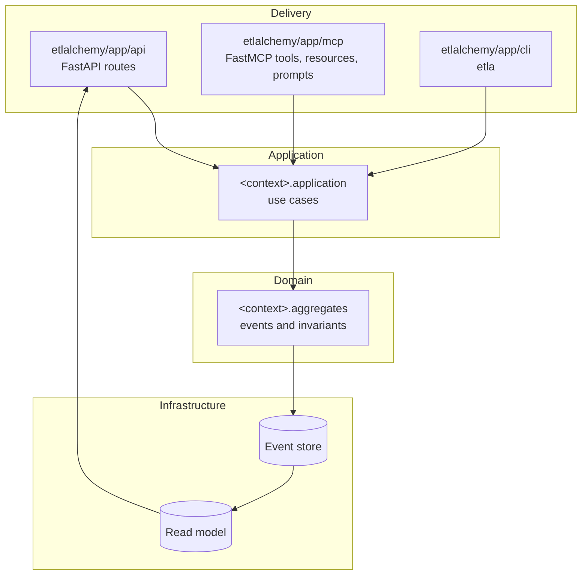
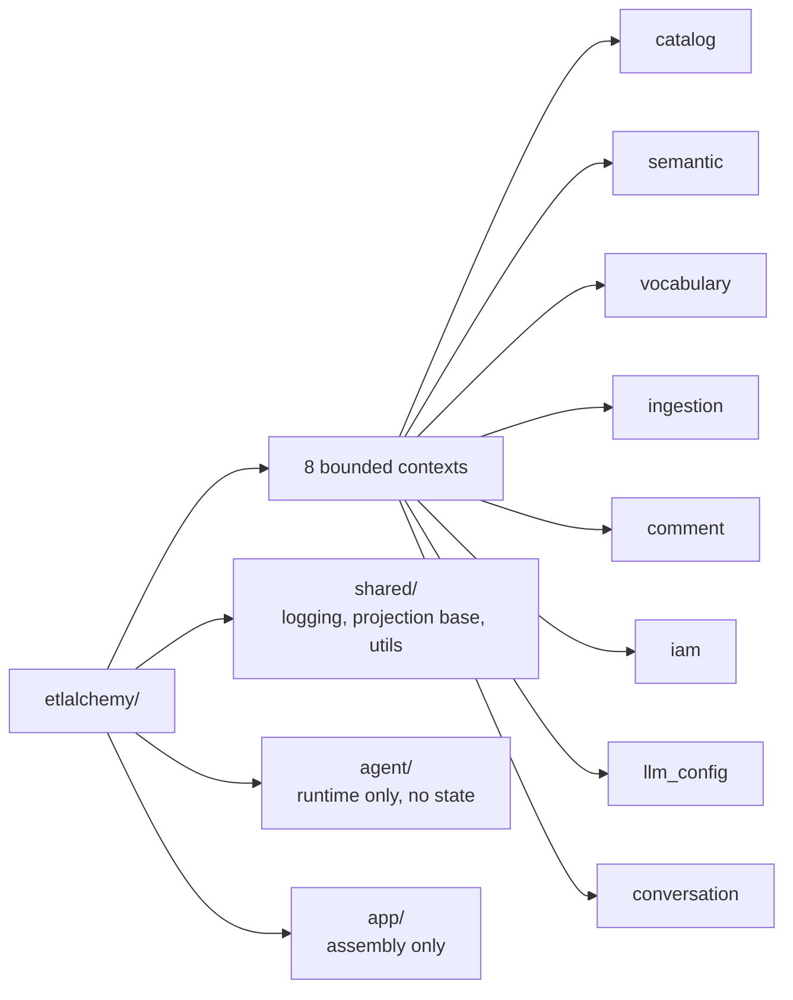
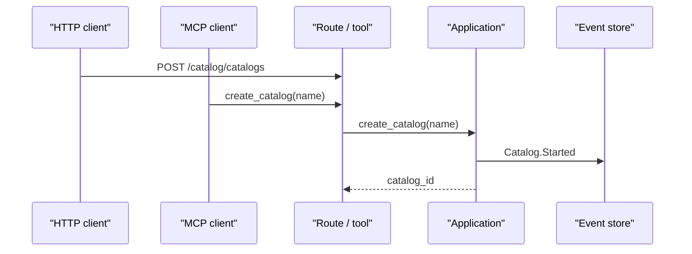
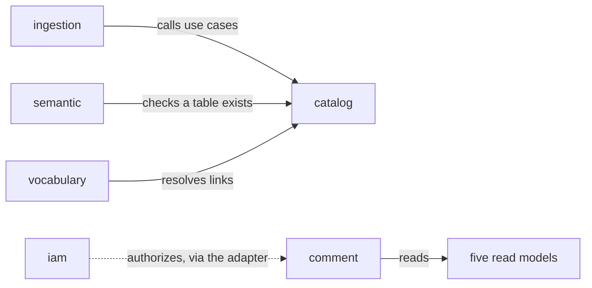

# Architecture

Why the code is organised the way it is, and how a request travels through it.

*Diátaxis type: explanation* · **Audience:** contributors · **Prerequisites:** [Event sourcing](event-sourcing.md)

**On this page**

- [Three layers, one direction](#three-layers-one-direction)
- [The package map](#the-package-map)
- [One use case, two deliveries](#one-use-case-two-deliveries)
- [The assembly layer](#the-assembly-layer)
- [Why contexts never import each other's objects](#why-contexts-never-import-each-others-objects)

## Three layers, one direction

*Figure 1: Dependencies point down and right, never up. A route may call an application; an aggregate may not know that FastAPI exists.*

The rule that keeps this honest is mechanical: a context may import
`etlalchemy/shared/` and its own modules, but never `etlalchemy.app`, never
FastAPI, never dependency-injector, never pydantic-settings. `etlalchemy/shared/`
itself may only import the standard library, `eventsourcing`,
`etlalchemy._vendor.eventsourcing` and `structlog`.

## The package map

*Figure 2: Eight contexts, three support packages. Only `app/` knows how the process is assembled.*

Each context has the same five files, which makes a new one predictable:

| File | Responsibility |
|---|---|
| `aggregates/<name>.py` | one aggregate root, its events and its invariants |
| `aggregates/errors.py` | the context's error hierarchy |
| `application.py` | use cases, atomic multi-aggregate saves |
| `projection/view.py` | the read interface and row dataclasses |
| `projection/sqlalchemy.py` | the single view class for SQLite and PostgreSQL |

`projection/projection.py` holds the projection and the runner factory,
`__init__.py` re-exports the public API (mypy runs with
`no_implicit_reexport`, so `__all__` is mandatory).

## One use case, two deliveries

*Figure 3: Both entry points converge immediately. Nothing in the delivery layer holds a rule, so a rule can never be true over HTTP and false over MCP.*

Response models live in `etlalchemy/app/schemas/` and are shared by both layers,
which is why a `409` and a `[conflict]` describe the same rejection.

## The assembly layer

`etlalchemy/app/` is the only place that wires things together:

| Module | Owns |
|---|---|
| `bootstrap/factories.py` | datastores, views, env resolvers |
| `bootstrap/container.py` | providers and wiring, no logic |
| `bootstrap/lifecycle.py` | `run_container`, `api_lifespan`, the `CONTEXTS` list |
| `bootstrap/settings.py` | `load_app_settings()` |
| `config/` | pydantic-settings models and the YAML loader |
| `api/` | app factory, routes, error mapping, request logging |
| `mcp/` | registry, server, one package per context |
| `cli/` | typer app and the `server` command |

Applications are **started by the lifecycle, not by their provider**: the
container only constructs them, so a request can never observe a
half-initialised application.

## Why contexts never import each other's objects

A context may hold another context's **id**, never its aggregate. That is what
allows `ingestion` to write through `CatalogApplication` without owning catalog
rules, and `comment` to resolve targets through the views. The cost is one extra
load; the benefit is that a change to `catalog` cannot break `iam`.

*Figure 4: Cross-context calls are explicit and few. `iam` reaches `comment` only through a port, so the dependency is visible in a constructor.*

## FAQ

**Why not one big `models.py`?** An aggregate is a consistency boundary. Merging
two of them makes every write contend on one stream.

**Why is the read model in the same package as the aggregate?** The view is
derived from the same events, so its rows are the context's own vocabulary; only
the tables are separate.

**Where do I put a query that spans contexts?** In the delivery layer, over two
views — or in one context's own module (as `vocabulary/links.py` resolves catalog
objects) when the result belongs to that context.

## See also

- [Event sourcing](event-sourcing.md) — the aggregate in detail
- [Read model](read-model.md) — the projection in detail
- [Add a bounded context](../guides/add-a-bounded-context.md) — the same map as a checklist
