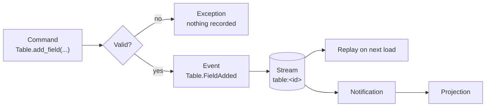
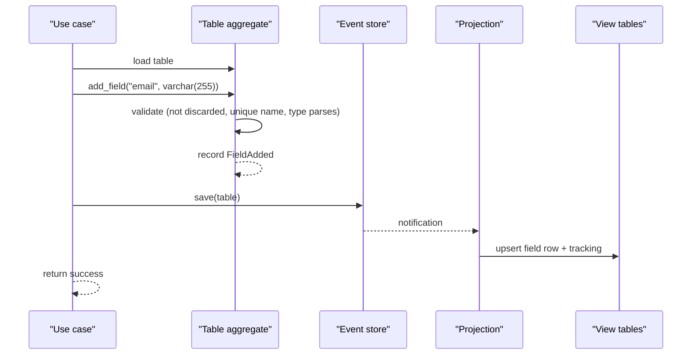
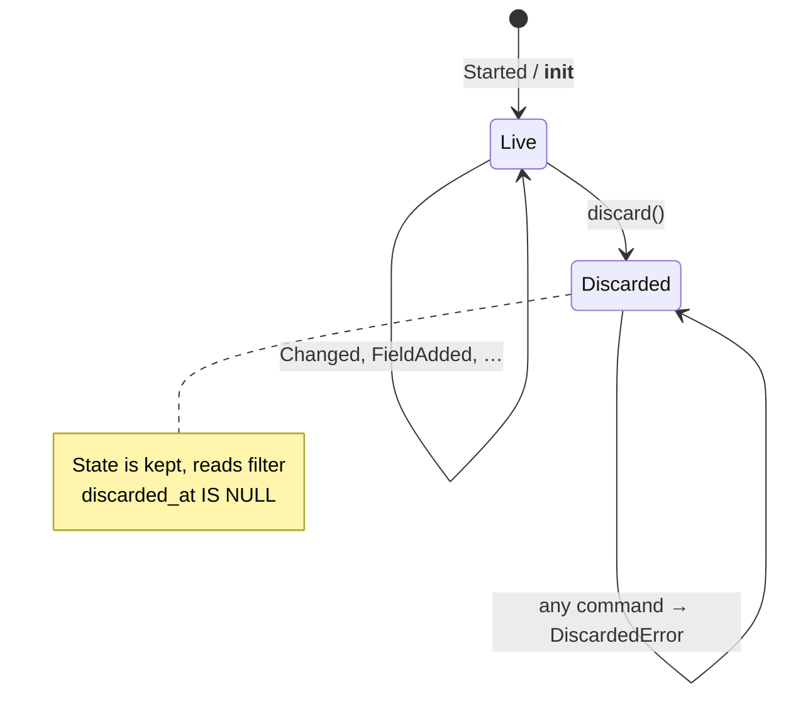

# Event sourcing

Why every change is recorded as an immutable fact, and what that buys the
service.

*Diátaxis type: explanation* · **Audience:** contributors · **Prerequisites:** none

**On this page**

- [The idea](#the-idea)
- [One command, end to end](#one-command-end-to-end)
- [The aggregate's lifecycle](#the-aggregates-lifecycle)
- [Rules that keep replay honest](#rules-that-keep-replay-honest)
- [What it costs](#what-it-costs)

## The idea

An aggregate's state is not stored; it is **derived** from the events that
happened to it. Saving a command appends events to a stream; loading an
aggregate replays that stream through `__init__` and the event handlers.

*Figure 1: A rejected command leaves the stream and the version untouched. Only the reader of the stream ever rebuilds state.*

This is why the application can answer "what changed" without an audit table: the
stream *is* the audit.

## One command, end to end

*Figure 2: Validation and recording happen inside the aggregate; persistence and projection come after. If the projection fails, the event is still in the store — the projection retries from its tracking row.*

The unit of work may span several aggregates: creating a schema and registering it
in its catalog is one `save(catalog, schema)`, so the parent's name → id registry
can never miss the child.

## The aggregate's lifecycle

*Figure 3: Soft delete is a state, not a row removal. Every mutating command starts with `_ensure_not_discarded()`, which is why a discarded aggregate cannot silently come back.*

Discarding a parent cascades: `catalog.unregister_schema(...)` and
`schema.unregister_table(...)` record the removal on the parent in the same unit
of work, so the registry and the child agree.

## Rules that keep replay honest

| Rule | Why |
|---|---|
| Events are frozen dataclasses inside the aggregate | replay constructs them from stored state |
| Bind with `@event(EventClass)`; never call `self.trigger_event` | the decorator records and applies consistently |
| Never define `apply()` on an event class | state changes belong to the aggregate |
| Validate **before** mutating | a failed command must not leave pending events or a new version |
| Reference other aggregates by `UUID` | replay must not depend on another stream |
| Never change a field of an existing event class | old rows are decoded by field name; add a new event instead |
| Register custom value objects as transcodings | a missing transcoding breaks replay, not just the projection |

The last two rules are the ones that bite in practice: adding a field to
`AssistantMessageCompleted` would break every stored row, which is exactly why
reasoning is recorded as a separate `AssistantMessageReasoned` event.

## What it costs

Optimistic concurrency means two commands on the **same** stream cannot both win:
the loser gets `RecordConflictError` (HTTP `409`). Different tables are different
streams, so a bulk operation can proceed in parallel — one conflict per table,
not one per request.

Storage grows monotonically. Nothing is compacted; a discarded aggregate keeps
its history, which is usually the point.

## FAQ

**Can I query events directly?** You can, but not in application code: reads go
through the read model, which is built for them.

**What if two events contradict each other?** They cannot — the aggregate
validated each one against the state produced by the previous ones.

**How do I migrate a schema?** Add events and, if needed, teach the projection a
second shape; never rewrite stored events.

## See also

- [Read model](read-model.md) — what happens after the notification
- [Data store tables](../reference/data-model.md) — where the streams live
- [Architecture](architecture.md) — how a context is packaged
