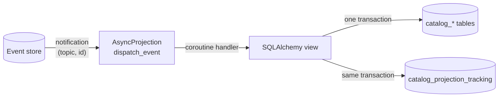
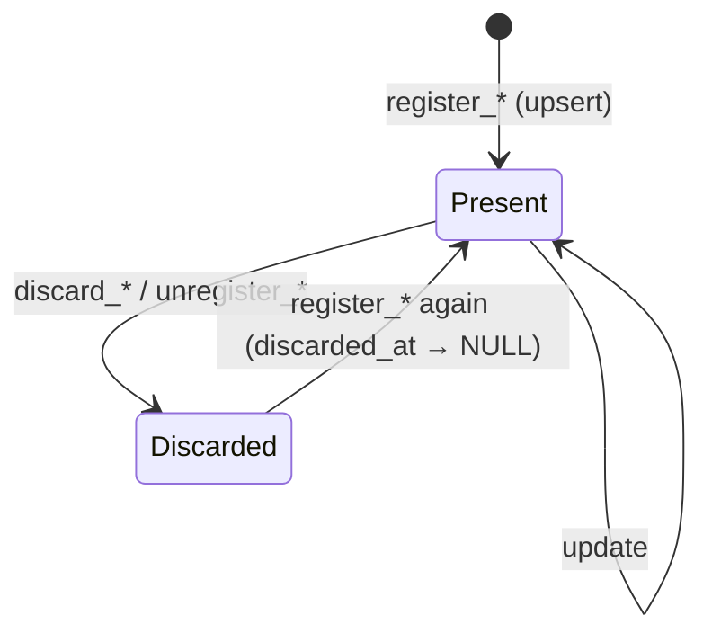

# Read model

How a query is answered without replaying a single event, and why a read can lag
a write.

*Diátaxis type: explanation* · **Audience:** contributors · **Prerequisites:** [Event sourcing](event-sourcing.md)

**On this page**

- [Projection, tracking, view](#projection-tracking-view)
- [One transaction per event](#one-transaction-per-event)
- [Why a read can lag](#why-a-read-can-lag)
- [Soft delete in the read model](#soft-delete-in-the-read-model)
- [The rules the view follows](#the-rules-the-view-follows)

## Projection, tracking, view



*Figure 1: The projection dispatches by event type; the view writes the row **and** its tracking marker in one transaction, so an event is applied exactly once.*

The projection is not a poller: the async recorders implement `subscribe()` for
both backends, so no polling topic is configured. `run_<context>_projection()`
returns an `AsyncProjectionRunner` that the lifecycle starts and stops.

## One transaction per event

```python
async with self.transaction() as conn:
    await conn.execute(stmt)
    await self.insert_tracking_in_transaction(conn, tracking)
```

A view write that committed without its tracking row would be applied again on
restart — that is the whole reason both statements share a transaction. It also
means a projection may insert exactly **one** tracking row per transaction, which
is why a cascade (discard a user, revoke its sessions, delete its rules) is a
single view method, not four calls.

## Why a read can lag

The write returns as soon as the events are saved; the projection applies them
just afterwards. Anything that reads immediately can therefore see the previous
state.

| Symptom | Consequence |
|---|---|
| `GET` straight after `POST` misses the new row | create routes answer from the aggregate, not the view |
| a test flake on the first assertion | poll a value-based predicate, never "list is not empty" |
| a duplicate-check query says "free" | uniqueness lives in the aggregate, so the write still rejects |
| a logout takes a moment to bite | revocation is projected; clients poll for the `401` |

`create_table()` creates the view tables and the tracking table **before** the
application starts, so an event is never notified into a table that does not
exist yet.

## Soft delete in the read model



*Figure 2: The same upsert both creates and revives a row, because a discarded name may be reused.*

Every `get_*`, `list_*`, `find_*` and `search_*` filters
`discarded_at IS NULL`; `register_*` resets it. Discarding a parent cascades to
its children, while field rows are deleted outright.

Name uniqueness is **not** a database constraint: the `(parent, name)` unique
indexes were removed so a discarded name can be reused. The aggregate owns that
rule.

## The rules the view follows

| Rule | Reason |
|---|---|
| SQLAlchemy Core only in `projection/tables.py` and `sqlalchemy.py` | one place to review DML |
| Upsert chosen by `datastore.dialect_name` | SQLite and PostgreSQL share one class |
| Structure commands are upserts | a replayed command is idempotent |
| No engine, no session, no raw SQL text | the recorder owns the connection |
| `sa.Uuid` / `sa.DateTime(timezone=True)` columns | binds `UUID` and datetimes on both dialects |
| `create_table()` also migrates added columns | an older database keeps working |

Growing a view schema is done by adding a column in `create_table()`: SQLite uses
`PRAGMA table_info` plus `ALTER TABLE ADD COLUMN`, PostgreSQL uses
`ADD COLUMN IF NOT EXISTS`.

## FAQ

**Why not query the event streams directly?** Every read would replay and every
filter would scan events; the view is the queryable shape.

**Can I rebuild a view from scratch?** Drop its tables and start the projection —
it replays every event, because the tracking table went with them.

**Do views log?** No. Projections log `projection.event` at debug; the views stay
silent because they run once per event and once per read.

## See also

- [Data store tables](../reference/data-model.md) — the table inventory
- [Event sourcing](event-sourcing.md) — where the events come from
- [Add a bounded context](../guides/add-a-bounded-context.md) — writing a view
