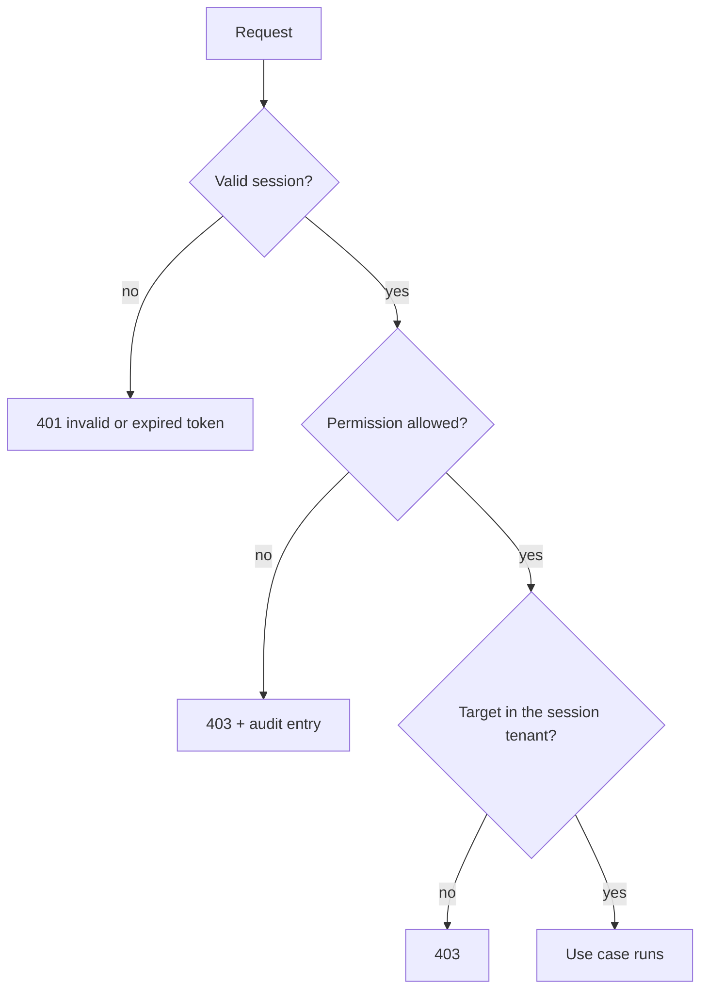
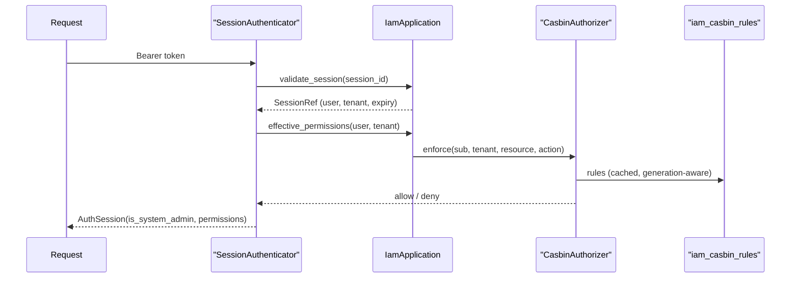

# Security model

Who is authenticated, what they may do, and what encryption does and does not
cover.

*Diátaxis type: explanation* · **Audience:** operators and contributors · **Prerequisites:** none

**On this page**

- [Three separate questions](#three-separate-questions)
- [One authenticator for both layers](#one-authenticator-for-both-layers)
- [Permissions and tenancy](#permissions-and-tenancy)
- [What is protected today](#what-is-protected-today)
- [Encryption at rest](#encryption-at-rest)

## Three separate questions

*Figure 1: Authentication, authorization and tenancy are three checks, not one. A valid token is never enough on its own.*

## One authenticator for both layers

`etlalchemy/app/auth/SessionAuthenticator` is the single verification path. It
calls `IamApplication.validate_session` (expiry, revocation, credential version)
and `effective_permissions`, and answers one uniform `InvalidTokenError` for
every rejection — a client cannot tell a revoked session from a malformed token.

The token is opaque: `<bearer_token_prefix><session_id>` (`iam_sess_…`). HTTP
reads it from `Authorization: Bearer`; the MCP server reads it at transport level
through `IamTokenVerifier`. There is no second validator, and the session id
never travels in a body, a query string or a path.

A credential change increments `Identity.credential_version`, so sessions issued
before the change are rejected even before the projection revokes them.

## Permissions and tenancy

| Concept | Behaviour |
|---|---|
| Permission | `resource:action`, parsed and validated; granted to a **group** |
| Group nesting | a child group inherits its ancestors' grants |
| Casbin | the read model writes `iam_casbin_rules`; the authorizer rebuilds its in-memory enforcer on a generation bump or TTL expiry |
| Tenant | memberships scope both permissions and data |
| Session without a tenant | evaluates across all memberships (typical of an API key) |
| System administrator | exempt from tenant scoping |

*Figure 2: One call resolves a token into a decision, so both delivery layers agree by construction.*

Denied authorizations are recorded as a `Session.AccessDenied` event and land in
`iam_audit_log`, next to the audit row every write attaches to its own event.

## What is protected today

| Surface | Token required |
|---|---|
| `/iam/*` except `/auth/*`, `/bootstrap`, `/authorize` | yes |
| `/comments/*` | yes (reads too, unless `read_requires_session: false`) |
| `/agent/*` | yes |
| `/mcp` | yes, while `mcp.require_auth` is true (the default) |
| `/catalog`, `/semantic`, `/vocabulary`, `/ingestion` | **not yet** |

!!! warning "The metadata routes are open"
    `catalog`, `semantic`, `vocabulary` and `ingestion` do not verify a token
    today. Treat a deployment that exposes them beyond a trusted network as
    unauthenticated data, and put them behind a gateway until the dependency is
    added.

## Encryption at rest

The event store can be encrypted with `cipher_key`: every event's `state` is an
AES blob. The read model is **not** encrypted, so database access controls still
matter — and a projection that runs without the key cannot decode the stream.

Secrets are referenced, not stored: `credential_ref: env:…`, `file:…` or
`profile:…`. An inline token is the exception, and it is only allowed when
`cipher_key` is set. Logs never contain a credential; the agent's tool previews
are redacted against `agent.tools.redact_argument_keys` before they are stored.

## FAQ

**Where do I grant my first permission?** `etla iam admin grant`, or
`POST /iam/tenants/{id}/groups/{group_id}/permissions` with a session.

**Can a tenant-scoped provider authenticate a user from another tenant?** No; the
call is rejected, and an unknown OIDC subject answers `UnboundOidcIdentity`
because there is no first-login auto-registration.

**Does logout take effect immediately?** It takes effect when the projection
applies the revocation event; poll for the `401`.

## See also

- [First administrator and token](../getting-started/first-admin.md) — the bootstrap flow
- [Encrypt events at rest](../guides/enable-event-encryption.md) — the key in practice
- [Connect an MCP client](../guides/connect-the-mcp-server.md) — transport auth
