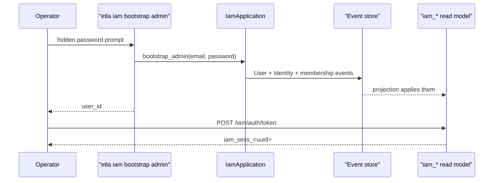

# First administrator and token

Create the very first system administrator through the CLI and exchange its
password for a bearer token the API and the MCP server accept.

*Diátaxis type: tutorial* · **Audience:** operators · **Time:** 10 minutes

## Before you start

The server has been started once ([Run it locally](run-locally.md)), so the
event store and the read model exist. The CLI builds its own container over the
same configuration; the server does **not** have to be running.

## Why the CLI and not a route



*Figure 1: The bootstrap path. Creating the first administrator cannot need a token, so it is the one IAM write that only exists in the CLI (and behind `POST /iam/bootstrap` on a fresh install).*

## 1. Check the state

```bash
uv run etla iam bootstrap status
```

`not initialized` means no system administrator exists yet. Add `--json` for
machine-readable output.

## 2. Create the administrator

```bash
uv run etla iam bootstrap admin --email you@example.com
```

The password is read from a hidden prompt (entered twice). It is never an
option, so it cannot leak through your shell history or a process listing. For
automation, feed both lines on stdin:

```bash
printf 'Passw0rd!\nPassw0rd!\n' | uv run etla iam bootstrap admin --email you@example.com
```

The command prints the new user id.

!!! warning "A password prompt that swallows your terminal"
    `typer.prompt(hide_input=True)` needs a TTY for a pleasant experience but
    works from a pipe. If the command appears to hang, it is waiting for the
    second line: send the password twice.

## 3. Exchange the password for a token

```bash
TOKEN=$(curl -s -X POST http://localhost:8000/iam/auth/token \
  -d 'username=you@example.com' -d 'password=Passw0rd!' \
  | sed -n 's/.*"access_token":"\([^"]*\)".*/\1/p')
echo "$TOKEN"
```

The route takes an `OAuth2PasswordRequestForm`, so Swagger UI's **Authorize**
button works with the same credentials. A tenant is selected with the form
scope, `-d 'scope=tenant:<tenant_id>'`; without it the session has no tenant and
authorizes across your memberships.

## 4. Use the token

```bash
curl -s http://localhost:8000/iam/sessions/current -H "Authorization: Bearer $TOKEN"
```

`GET /iam/sessions/current` is the only way to ask "who am I": the session id is
never accepted in a body, a query string or a path.

The token is opaque — `<bearer_token_prefix><session_id>`, `iam_sess_` by
default — and lives exactly as long as the session it names.

!!! tip "The CLI can keep the session for you"
    `uv run etla iam login --email you@example.com` stores the token, and
    protected commands then read `--session` or `$IAM_SESSION`. Exit code `3`
    means no session was supplied.

## FAQ

**I lost the password.** There is no reset route for the first administrator:
re-run `bootstrap admin` with another email, or `etla iam admin set-password`
with an existing session.

**The token stopped working.** Logout revokes the session through an event, so
revocation is applied by the projection — poll for the `401` instead of
asserting it immediately.

**Do catalog routes need it?** Not today. Only `/iam/*`, `/comments/*` and
`/agent/*` verify the token; see the [Security model](../concepts/security.md).

## See also

- [CLI](../reference/cli.md) — every `etla iam` subcommand
- [Security model](../concepts/security.md) — sessions, scopes and permissions
- [HTTP API](../reference/http-api.md) — the IAM routes in full
