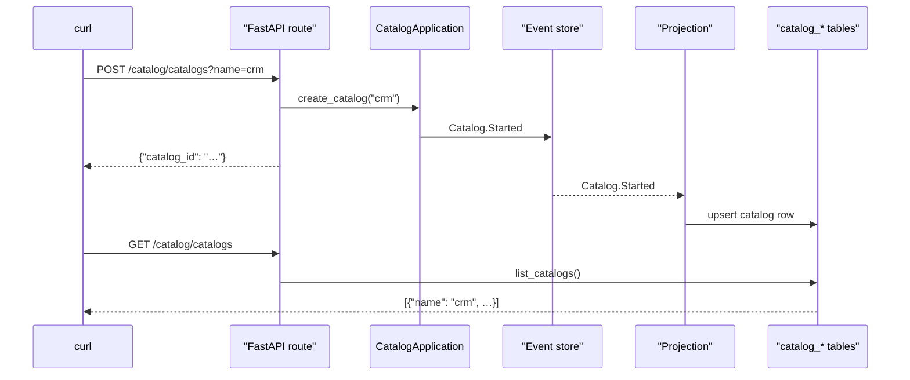

# Your first catalog

Create a catalog, a schema, a table and a field with `curl`, then read them back
from the read model.

*Diátaxis type: tutorial* · **Audience:** API consumers · **Time:** 10 minutes

## Before you start

The server answers on port 8000 ([Run it locally](run-locally.md)). No token is
needed for the catalog routes.

## The four write calls



*Figure 1: A command is answered from the aggregate, a query from the read model. The projection applies `Catalog.Started` between the two requests, so the write returns an id before the row exists.*

## 1. Create the catalog

```bash
CATALOG=$(curl -s -X POST 'http://localhost:8000/api/catalog/catalogs?name=crm' \
  | sed -n 's/.*"catalog_id":"\([^"]*\)".*/\1/p')
echo "$CATALOG"
```

An **id** is returned, not the object. Creation answers from the aggregate, so it
does not race the projection.

## 2. Add a schema

```bash
curl -s -X POST "http://localhost:8000/api/catalog/catalogs/$CATALOG/schemas?schema_name=sales"
```

## 3. Add a table

```bash
curl -s -X POST "http://localhost:8000/api/catalog/catalogs/$CATALOG/schemas/sales/tables?table_name=contacts"
```

`sales` is a registry **name**; a schema id works in the same position, which
keeps links valid after a rename.

## 4. Add a field

```bash
curl -s -X POST \
  "http://localhost:8000/api/catalog/catalogs/$CATALOG/schemas/sales/tables/contacts/fields?field_name=email&data_type=varchar(255)&nullable=false"
```

`data_type` is parsed and normalised (`VARCHAR(255)` → `varchar(255)`); an
unknown or wrongly parameterised type is a `400`.

## 5. Read it back

```bash
curl -s "http://localhost:8000/api/catalog/catalogs/$CATALOG/schemas/sales/tables/contacts/fields"
```

```json
[{"table_id": "…", "field_id": "…", "name": "email",
  "data_type": "varchar(255)", "nullable": false, "comment": ""}]
```

If the list is empty immediately after the write, wait a moment: reads come from
the projection, which applies the event asynchronously.

## 6. Change and discard

```bash
curl -s -X PATCH "http://localhost:8000/api/catalog/catalogs/$CATALOG/schemas/sales/tables/contacts" \
  -H 'Content-Type: application/json' -d '{"description": "One row per person."}'
curl -s -o /dev/null -w '%{http_code}\n' -X DELETE \
  "http://localhost:8000/api/catalog/catalogs/$CATALOG/schemas/sales/tables/contacts"
```

`204` is a soft delete: the row keeps its `discarded_at`, every read filters it
out, and the name can be reused.

!!! warning "Names are unique only among live rows"
    Recreating `contacts` after a discard succeeds — the aggregate, not a
    database constraint, enforces uniqueness. Do not build deduplication on a
    unique index.

## FAQ

**Why is the id different from the name?** Renaming changes the name; the id is
stable, so ids are the safe thing to store in links.

**Can I create two catalogs with the same name?** No, `DuplicateCatalogError` is
a `409`.

**Where do the events live?** SQLite: `./catalog.db`; PostgreSQL:
`catalog_application_events`. See [Data store tables](../reference/data-model.md).

## See also

- [HTTP API](../reference/http-api.md) — the full catalog route table
- [Event sourcing](../concepts/event-sourcing.md) — why the write returns an id
- [Read model](../concepts/read-model.md) — why the read can lag
