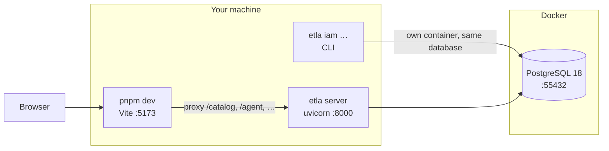

# Prerequisites

Everything the tutorials assume is already installed: `uv`, Docker, `pnpm` and a
free port 8000, 5173 and 55432.

*Diátaxis type: tutorial* · **Audience:** first-time contributors · **Time:** 10 minutes

## What you need

| Tool | Why | Check |
|---|---|---|
| `uv` | Python 3.13, the virtualenv and every dependency | `uv --version` |
| Docker with Compose v2 | the local PostgreSQL 18 instance | `docker compose version` |
| `node` 20+ and `pnpm` | only for the web UI | `pnpm --version` |
| `psql` (optional) | inspecting the read model by hand | `psql --version` |

`uv` supplies Python 3.13 itself, so you do not need a system interpreter: the
project declares `requires-python = ">=3.13"` and `uv sync` provisions it.

!!! warning "No system Python required — and none is used"
    Never run the tests with the interpreter on your `PATH`. `uv run …` puts the
    project virtualenv first; `python -m pytest` from the repository root uses a
    different environment and fails on missing dependencies.

## What runs on your machine



*Figure 1: Four processes. The CLI does not call the HTTP API — it builds its own container over the same database, which is why it can create the first administrator before any token exists.*

The host port of PostgreSQL is **55432**, not 5432, so a locally installed
PostgreSQL is never shadowed.

## Environment variables you may want

| Variable | Purpose |
|---|---|
| `DEEPSEEK_API_KEY` | credential of the example LLM provider; only the agent needs it |
| `ETLALCHEMY_CIPHER_KEY` | base64 key that encrypts event state at rest |
| `TEST_DATABASE_URL` | turns the skipped PostgreSQL integration tests on |
| `ETLALCHEMY_MCP__REQUIRE_AUTH` | set to `false` only for local MCP tools |

Every setting is also a `ETLALCHEMY_*` variable; the naming rule (`__` per
nesting level) is in [Configure the service](../guides/configure-settings.md).

## Verify the checkout

```bash
git clone https://github.com/liang-guang-jun/etlalchemy.git
cd etlalchemy
uv sync
uv run python -c "import etlalchemy, sys; print(sys.version)"
```

The package is installed editable, and every dependency — `eventsourcing`
including — comes from PyPI, so `uv sync` works in a fresh clone. The
asynchronous infrastructure this service is built on (`AsyncApplication`,
`AsyncProjection`, the SQLAlchemy recorders) is not published by the library; it
ships vendored in `etlalchemy/_vendor/eventsourcing/asyncio/`, so nothing has to
be checked out next to this repository.

## FAQ

**Do I need Docker at all?** No — the default backend is SQLite
(`./catalog.db`). Docker is for the PostgreSQL path and for the integration
tests.

**Which port does MCP use?** The same as the API; the server is served at
`/mcp` on port 8000.

**Can I run the UI without the backend?** It loads, but every request fails; the
Vite proxy has nothing to forward to.

## See also

- [Run it locally](run-locally.md) — start the server and prove it answers
- [Run the frontend](../guides/run-the-frontend.md) — the Vite dev server
- [Configuration](../reference/configuration.md) — every key you can set
