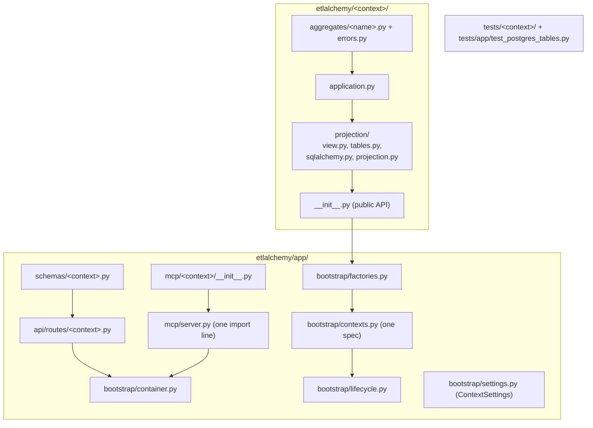

# Add a bounded context

Scaffold a new context — aggregates, application, read model, delivery layers and
tests — without breaking a convention.

*Diátaxis type: how-to* · **Audience:** backend contributors · **Time:** 90 minutes

**On this page**

- [What you touch](#what-you-touch)
- [Aggregates](#1-aggregates)
- [Application](#2-application)
- [Read model](#3-read-model)
- [Assembly](#4-assembly)
- [Tests](#5-tests)
- [Prove the contract](#6-prove-the-contract)

## Before you start

You have read [Event sourcing](../concepts/event-sourcing.md) and
[Read model](../concepts/read-model.md), and the gates are green
([Run the quality gates](run-quality-gates.md)).

## What you touch



*Figure 1: A context is written bottom-up: aggregates first, then the application, then the projection; only afterwards are the delivery layers and the assembly wired to it.*

`.github/prompts/new-context.prompt.md` walks an assistant through this list; the
steps below are the shape it produces.

## 1. Aggregates

One module per aggregate root, plus `errors.py` with a context base error:

```python
class WarehouseError(RuntimeError):
    """Base class of the warehouse context."""


class DiscardedError(WarehouseError):
    """Raised when a command touches a discarded aggregate."""
```

Events are frozen dataclasses declared inside the aggregate and bound with
`@event(...)`. Validate **before** mutating, and start every mutating command
with `_ensure_not_discarded()`.

## 2. Application

```python
class WarehouseApplication(AsyncApplication[UUID]):
    """Use cases of the warehouse context."""

    name = "warehouse_application"
```

Cross-aggregate work saves both sides in one unit of work (`self.save(parent,
child)`); a child is referenced by `UUID`, never by object.

## 3. Read model

Four files, in this order: `view.py` (protocol + row dataclasses),
`tables.py` (SQLAlchemy Core metadata), `sqlalchemy.py` (the single view class,
`AsyncSQLAlchemyTrackingRecorder`), `projection.py` (`AsyncProjection` +
`run_warehouse_projection()`).

| Rule | Why |
|---|---|
| One view class for SQLite and PostgreSQL | the dialect picks the upsert |
| `self.transaction()` + `insert_tracking_in_transaction` | a view write and its tracking row must commit together |
| soft delete via `discarded_at` | a name may be reused |
| no `(parent, name)` unique constraint | uniqueness belongs to the aggregate |

```python
class WarehouseProjection(AsyncLoggedProjection[SQLAlchemyWarehouseView]):
    """Projects warehouse events into the read model."""

    name = "warehouse_projection"
```

The view extends `etlalchemy.shared.persistence.AsyncCoreView`, which supplies
`_write`, `_fetch_all`, `_fetch_one` and `create_table` (calling a `migrate`
hook for columns an older table predates). A new view therefore declares only
`view_metadata` and its own commands — never a private copy of those helpers.

## 4. Assembly

| File | Add |
|---|---|
| `bootstrap/factories.py` | `WarehouseViewFactory(ViewFactory)` with `view_class` + `runner_factory` |
| `bootstrap/settings.py` | `WarehouseSettings` with its own tracking table |
| `bootstrap/contexts.py` | one `("warehouse", WarehouseViewFactory(), WarehouseApplication)` entry |
| `bootstrap/container.py` | only what the common shape does not cover (extra ports, options) |
| `app/schemas/warehouse.py` | `*Response` models with `from_row` |
| `app/api/routes/warehouse.py` | `APIRouter(prefix="/warehouse")` + `add_exception_handlers` |
| `mcp/warehouse/__init__.py` | `@mcp_context("warehouse", INSTRUCTIONS)` + `register` |
| `mcp/server.py` | one import line — that is the registration entry point |

`bootstrap/contexts.py` is the single registry: the lifecycle starts every spec
in order, the HTTP application includes its router and error handlers, and
`tests/app/test_postgres_tables.py` derives the expected table names from it. A
context added there needs no edit in `lifecycle.py` or `api/app.py`.

A context nobody imports in `mcp/server.py` is silently absent from the MCP
server. Mount without a namespace: a namespace renames every tool, resource and
prompt.

## 5. Tests

Mirror the package: `tests/warehouse/aggregates/`, `test_application.py`,
`projection/test_view_sqlite.py` and `projection/test_view_postgres.py` (the
latter with the `integration` marker). Add the new table names to
`tests/app/test_postgres_tables.py`.

## 6. Prove the contract

```bash
uv run ruff check . && uv run ruff format --check . && uv run mypy && uv run pytest -q
```

!!! warning "Table naming is not optional"
    Set `WarehouseApplication.name = "warehouse_application"` and
    `WarehouseProjection.name = "warehouse_projection"`. PostgreSQL derives
    `warehouse_application_events` and `warehouse_projection_tracking` from them,
    and every view table is `warehouse_<plural>`. A camelCase table is a bug.

## FAQ

**Do I need an MCP context?** Only if the context must be operable by the agent.
The HTTP layer alone is a complete delivery path.

**Where does a query belong?** In the application if it composes several
aggregates; straight from the view in a route if it is one indexed lookup.

**Must the projection be enabled?** `projection.enabled: false` starts the
context without a runner — useful for a writer-only deployment, but reads then
return stale rows.

## See also

- [Architecture](../concepts/architecture.md) — the package map
- [Data store tables](../reference/data-model.md) — the naming rules in full
- [MCP surface](../reference/mcp-surface.md) — how a context is mounted
