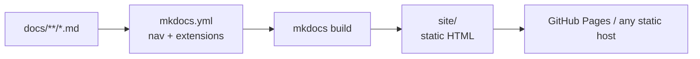
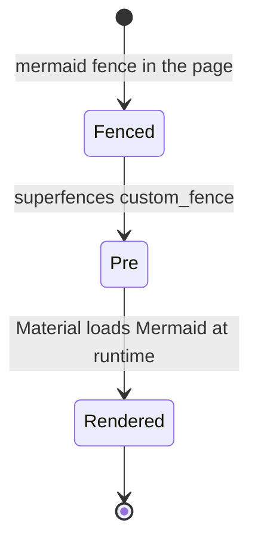

# Build the documentation

Preview the site locally, build it strictly, and publish it as static pages.

*Diátaxis type: how-to* · **Audience:** documentation contributors · **Time:** 5 minutes

## Before you start

`uv` installed and the repository cloned. The docs toolchain lives in the `docs`
dependency group, so the service install does not carry it.

## Three commands

```bash
uv run --group docs mkdocs serve          # http://127.0.0.1:8000, live reload
uv run --group docs mkdocs build --strict # fail on any warning
uv run --group docs mkdocs build          # static output in site/
```



*Figure 1: One source tree, one configuration, one static output. Nothing is generated from the README — it holds a single pointer line.*

`mkdocs serve` uses port 8000, which collides with `etla server`; run one at a
time or pass `-a 127.0.0.1:8100`.

## Why `--strict`

`mkdocs build --strict` turns every warning into an error. That is what keeps
this documentation honest: a link to a deleted page, a Markdown file missing from
`nav`, or an image that does not exist fails the build instead of shipping a
broken sidebar.

!!! warning "New pages must be in `nav`"
    `nav` is written out by hand — deliberately, so the sidebar order is
    controlled rather than inferred. A page that is not listed is an orphan and
    fails the strict build.

## Mermaid

Diagrams are fenced blocks tagged `mermaid`. `mkdocs.yml` binds that fence to
`pymdownx.superfences`, and Material renders it in the browser, so no Mermaid
plugin and no Node build step is involved.



*Figure 2: The rendering path is three steps long, all of it inside the browser.*

Keep node labels with punctuation in double quotes (`A["User request (HTTP)"]`);
an unquoted parenthesis is a parse error that silently blanks the diagram.

## Publishing

`site/` is git-ignored. Any static host works: upload `site/`, or let CI run
`mkdocs gh-deploy`. `site_url` in `mkdocs.yml` must match the published URL so
the canonical links and the sitemap are correct.

## FAQ

**The build warns about an omitted file.** A Markdown file under `docs/` is not
in `nav`; add it or delete it.

**A diagram is blank.** Almost always a quoting problem, or `<`/`>` written raw
inside a label — use `&lt;`/`&gt;`.

**Can I use the retired README?** No. It contains one line pointing here.

## See also

- [Glossary](../reference/glossary.md) — the vocabulary this documentation uses
- [Architecture](../concepts/architecture.md) — a page worth adding a diagram to
