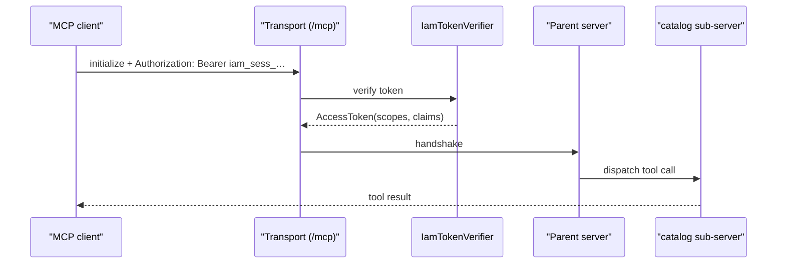

# Connect an MCP client

Point an MCP-capable client — an IDE, the MCP Inspector, your own script — at
the tools ETLAlchemy exposes.

*Diátaxis type: how-to* · **Audience:** tool builders · **Time:** 15 minutes

## Before you start

The server runs ([Run it locally](../getting-started/run-locally.md)) and you
hold a token if `mcp.require_auth` is on
([First administrator and token](../getting-started/first-admin.md)).

## What a client talks to



*Figure 1: Authentication is transport level. A mounted sub-server has no auth of its own — the parent app enforces the token for all of them.*

## Point a client at the HTTP endpoint

Every client that speaks streamable HTTP needs the same two values:

| Setting | Value |
|---|---|
| URL | `http://localhost:8000/mcp` |
| Header | `Authorization: Bearer <token>` |

```json
{
  "mcpServers": {
    "etlalchemy": {
      "url": "http://localhost:8000/mcp",
      "headers": { "Authorization": "Bearer ${env:ETLALCHEMY_TOKEN}" }
    }
  }
}
```

Tool names are **not** namespaced: a client sees `create_catalog`,
`list_terms`, `plan_import`, not `catalog_create_catalog`.

!!! warning "Mount paths that look right and are not"
    `/mcp` is served by extending the FastAPI router with the MCP app's routes.
    Mounting it as a sub-application produces either a trailing-slash `307` or
    `/mcp/mcp`. If a client "connects" but no tool ever loads, check the status
    code of the handshake first.

## Use the MCP Inspector locally

The inspector starts the server itself, so it needs the container lifespan and
a configuration without transport auth:

```bash
ETLALCHEMY_MCP__REQUIRE_AUTH=false \
  uv run fastmcp dev inspector etlalchemy/app/mcp/dev.py:create_mcp_server
```

`create_mcp_server` is a no-argument factory: the CLI resolves a single attribute
name (no dotted path), and the factory builds the container, the read-model
tables and the sub-servers on its own.

## Discover what is available

```bash
curl -s -X POST http://localhost:8000/mcp \
  -H "Authorization: Bearer $TOKEN" \
  -H 'Content-Type: application/json' \
  -H 'Accept: application/json, text/event-stream' \
  -d '{"jsonrpc":"2.0","id":1,"method":"tools/list"}'
```

Resources carry whole trees (`catalog:///all`, `semantic:///models`,
`vocabulary:///domains`); tools carry the writes and the parameterised reads.
The full inventory is in [MCP surface](../reference/mcp-surface.md).

## FAQ

**Calls fail with `[conflict]`.** That is the tool-level error text, not a
transport error: the input was rejected by a domain rule. `[not_found]` and
`[internal]` behave the same way.

**Can I use an API key instead?** Yes — `POST /iam/auth/api-key` exchanges one
for a session token, exactly as a password would.

**The in-memory transport in tests.** `fastmcp.Client(server.mcp)` bypasses HTTP
auth entirely; that is why the test configuration sets `require_auth: false` and
supplies a caller through a provider.

## See also

- [MCP surface](../reference/mcp-surface.md) — tools, resources, prompts, error prefixes
- [Security model](../concepts/security.md) — how the bearer token becomes scopes
- [Agent runtime](../concepts/agent-runtime.md) — a client already built in
