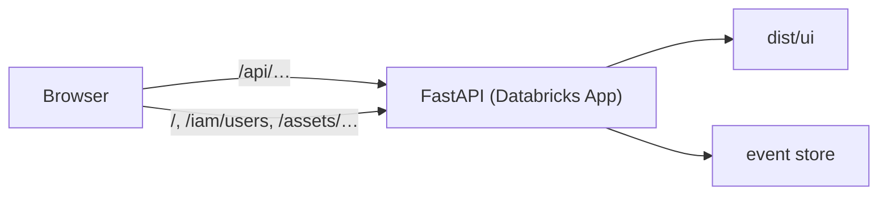

# Deploy to Databricks Apps

Publish the API and its web UI as one Databricks App, uploading only what
changed since the last run.

*Diátaxis type: how-to* · **Audience:** operators with a Databricks workspace · **Time:** 15 minutes

## Before you start

- The Databricks CLI is installed and a profile can reach the workspace
  (`databricks auth describe --profile <name>`), and the Python SDK is installed:
  `uv sync --extra databricks`.
- The app already exists: `databricks apps create etlalchemy`. The command
  deliberately never creates an app, so a typo in `--app-name` cannot produce a
  second one.
- `pnpm` is installed unless you pass `--no-build` with a prebuilt `dist/ui`.
- The app needs a database that outlives a restart. A Databricks App keeps only
  its workspace folder, so SQLite lives on ephemeral storage: pass a Postgres or
  Lakebase DSN through `--config` (the command warns when the resolved backend is
  `sqlite`).

## One origin, one artifact

The browser talks to `/api` on the origin that served the page, so nothing needs
CORS and nothing needs a proxy at runtime:



*Figure 1: `etla deploy` uploads the Python package, the built SPA and an `app.yaml`; the platform installs the dependencies and starts the process.*

## Deploy

```bash
uv run etla deploy --databricks-apps --profile DEFAULT \
  --config config.prod.yaml
```

1. **Preflight.** The profile is resolved through the Databricks SDK, the app is
   read with `GET /api/2.0/apps/{name}`, and the SPA is built with
   `pnpm build` when `dist/ui` is missing (`--build` forces it, `--no-build`
   forbids it).
2. **Staging.** A temporary tree is assembled: `etlalchemy/`, `dist/ui/`,
   `pyproject.toml` (with `[tool.uv] default-groups = []` so the platform does
   not install the dev tools), `uv.lock`, `README.md`, `LICENSE`, the
   configuration files, and a generated `app.yaml`.
3. **Snapshots.** The remote folder is listed level by level with concurrent
   requests, and every staged file is hashed. The `.etlalchemy-deploy.json`
   manifest from the previous run makes the comparison exact even when an edit
   keeps the byte count.
4. **Plan.** A table shows the target, how many files are added, updated or
   unchanged, the upload size and the stale files. `--dry-run` stops here.
5. **Upload.** Only added and updated files are written (`format=RAW`, so a
   `.py` file stays a file instead of becoming a notebook); missing folders are
   created first. `--prune` additionally deletes remote files that no longer
   exist locally.
6. **Deploy.** A `SNAPSHOT` deployment is created for the folder and polled
   until the platform reports `SUCCEEDED`; the app URL is printed last.

The generated `app.yaml` looks like this:

```yaml
command:
  - uv
  - run
  - uvicorn
  - etlalchemy.app.main:app
  - --host
  - 0.0.0.0
  - --port
  - $DATABRICKS_APP_PORT
health_check:
  path: /health
  timeout_seconds: 120
env:
  - name: ETLALCHEMY_CONFIG_FILES
    value: config.default.yaml:config.prod.yaml
```

`$DATABRICKS_APP_PORT` is substituted by the platform, and `/health` is the
liveness endpoint the API always answers.

## Every run after the first

The second run reads the manifest, finds no difference and prints an empty plan;
the upload step is skipped entirely. Editing one asset uploads that asset and the
manifest. Deleting a file only removes the remote copy with `--prune`.

## Options that matter

| Situation | Flag |
|---|---|
| first run in a new workspace folder | default; the folder is created |
| the app name differs from `deploy.databricks.app_name` | `--app-name` |
| the folder must be shared with a team | `--remote-path /Workspace/Shared/etlalchemy` |
| a frontend was built in CI | `--no-build` |
| a file is known to be stale on the remote side | `--prune` |
| the manifest is lost or a manual edit is suspected | `--force` |
| CI without a TTY | `--yes` |
| machine-readable output | `--json` |

## Failure modes

| Message | Cause |
|---|---|
| `the Databricks app '…' does not exist` | run `databricks apps create <name>` first |
| `the profile … records no workspace host` | `databricks configure --profile <name>` |
| `the frontend bundle is missing` | run `pnpm --dir frontend build` or drop `--no-build` |
| `… and the workspace import limit is 10485760 bytes` | one bundled asset exceeds the import limit; split it with `build.rollupOptions.output.manualChunks` |
| `deployment … ended in FAILED` | read `databricks apps logs <name>` |
| `stores cipher_key in the workspace` | move the value into an `env:`/`profile:` reference |

## See also

- [CLI reference](../reference/cli.md) — every option of `etla deploy`
- [Configuration](../reference/configuration.md) — `deploy.databricks.*` and `api.*`
- [Run the frontend](run-the-frontend.md) — the `/api` prefix in development
- [Security](../concepts/security.md) — what the deployed app protects
