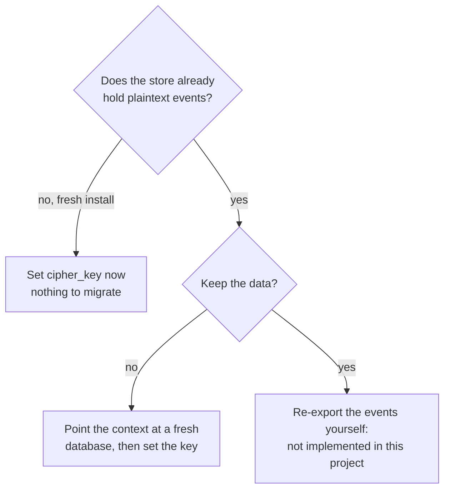

# Encrypt events at rest

Turn on AES encryption for every event the service writes, and understand what
it does to data that already exists.

*Diátaxis type: how-to* · **Audience:** operators · **Time:** 10 minutes

## Before you start

A database you can recreate, or a backup of it. Read the warning below before
you set a key on a store that already holds events.

## Decide first



*Figure 1: Encryption is a one-way door for existing rows, so the decision depends on whether the store is empty.*

## 1. Generate a key

```bash
uv run python -c "import base64,os;print(base64.b64encode(os.urandom(32)).decode())"
```

16, 24 or 32 raw bytes before base64. Anything else is rejected at settings
construction with a validation error.

## 2. Set it where secrets belong

```bash
export ETLALCHEMY_CIPHER_KEY='ecRkyusA1c9KGa5anPZSt7Bi2PXw7Or2cSb+iAa6XQo='
```

!!! warning "Never commit the key"
    `cipher_key` is a top-level setting and can be written to YAML, but in
    production it belongs in the environment (or a secret volume). A committed
    key protects nothing.

## 3. Restart and verify

```bash
uv run etla server
sqlite3 ./catalog.db "select count(*) from catalog_application_events where state not like '%crm%';"
```

Every event written from now on has an encrypted `state` blob; the `topic` and
`originator_id` columns stay readable because the event store needs them for
dispatching.

## What it changes

| Behaviour | With a key | Without a key |
|---|---|---|
| Event state on disk | AES ciphertext | plaintext dataclass repr |
| Inline `token` on an LLM provider | allowed | refused at startup |
| Reading pre-existing plaintext events | fails | works |
| Rotating the key | needs a full re-encrypt (not implemented) | n/a |

The cipher is wired into every consumer, not just the writers: both applications
and both projection runners receive `CIPHER_TOPIC`/`CIPHER_KEY`, so a runner
that started without it would fail to decode the stream.

!!! danger "Existing plaintext events become unreadable"
    The library decrypts every stored event as soon as a cipher is configured.
    Events written before you set the key cannot be read afterwards — there is
    no mixed-mode reader in `eventsourcing` 9.5.6. Treat enabling the key as
    "start a new event store", and revoke or rotate any inline credential that
    was stored in plaintext.

## FAQ

**Can I enable it per context?** No. The key is global; every context shares it.

**Does it encrypt the read model?** No. Only event state is encrypted; the
projection tables store plaintext, which is why database access controls still
matter.

**What if the key is wrong?** The applications fail while replaying or while
applying an event, and the projection stops advancing. Check the startup trail
for `projection.event.failed`.

## See also

- [Security model](../concepts/security.md) — what encryption does and does not cover
- [Configuration](../reference/configuration.md) — `cipher_key` and its validation
- [Data store tables](../reference/data-model.md) — where the ciphertext lives
