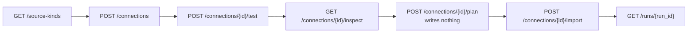

# Import a source database

Register an external source, inspect it, plan the import, then write its schema
into a catalog — all of it repeatable and read-only until the last step.

*Diátaxis type: how-to* · **Audience:** data engineers · **Time:** 20 minutes

## Before you start

A running server, a target catalog, and read-only credentials for the source.
For PostgreSQL sources the `postgres` source kind is built in; for Databricks the
`agent-databricks`/`databricks` extra must be installed.

## The pipeline



*Figure 1: Five steps. `plan` answers the same diff as `import` without writing, so a wrong `schema_mapping` costs one request instead of a catalog full of half-renamed schemas.*

## 1. Create the connection

```bash
CONN=$(curl -s -X POST http://localhost:8000/ingestion/connections \
  -H 'Content-Type: application/json' \
  -d '{
        "name": "warehouse",
        "kind": "postgres",
        "endpoint": "localhost:55432",
        "credential_ref": "env:SOURCE_PG_PASSWORD",
        "options": {"user": "etlalchemy", "database": "etlalchemy_test"}
      }' | sed -n 's/.*"connection_id":"\([^"]*\)".*/\1/p')
```

A connection carries **exactly one** credential source: an external reference
(`env:`, `file:`, `profile:`) or an inline `token`. Sending both, or neither, is a
`422`. An inline token lives in the event state, so it requires `cipher_key`.

!!! warning "`endpoint` is a host, not a DSN with a path"
    `host:port` or a full URL (`postgresql://host:port/db`) is understood;
    `host:55432/db` is treated as a hostname and fails DNS. Put the database name
    in `options.database` (or `default_catalog`).

## 2. Test it

```bash
curl -s -X POST "http://localhost:8000/ingestion/connections/$CONN/test"
```

The answer is `{"ok": true, "latency_ms": 12, "error": null}`; a failure fills
`error` instead of returning a `500`.

## 3. Look before you leap

```bash
curl -s "http://localhost:8000/ingestion/connections/$CONN/inspect?schema=public&table=contacts&limit=20"
curl -s -X POST "http://localhost:8000/ingestion/connections/$CONN/plan" \
  -H 'Content-Type: application/json' \
  -d "{\"target_catalog_id\": \"$CATALOG\", \"include_schemas\": [\"public\"]}"
```

`inspect` answers a node tree plus the columns of one table; `plan` answers the
target names it would create, the source types it cannot map and any warnings
(colliding target tables, unused schema mappings).

## 4. Import

```bash
curl -s -X POST "http://localhost:8000/ingestion/connections/$CONN/import" \
  -H 'Content-Type: application/json' \
  -d "{
        \"target_catalog_id\": \"$CATALOG\",
        \"include_schemas\": [\"public\"],
        \"include_tables\": {\"public\": [\"contacts\", \"orders\"]},
        \"schema_mapping\": {\"public\": \"sales\"}
      }"
```

| Field | Effect |
|---|---|
| `include_schemas` | only these source schemas, when non-empty |
| `include_tables` | per-schema table list; a non-empty list overrides `include_schemas`, an empty list skips that schema |
| `schema_mapping` | renames the target schema; several sources may map to one |

The import is synchronous: the request returns the finalised run with its
counters. Re-running it is idempotent — existing schemas and tables are reused,
and a changed column type is recorded as a change instead of a duplicate.

## 5. Read the history

```bash
curl -s http://localhost:8000/ingestion/runs
curl -s "http://localhost:8000/ingestion/runs/$RUN"
```

`started`, `status`, counters and the failure reason are in the read model; the
table column `created_at` is what the UI shows as *Started*.

## FAQ

**Everything imported as `json`.** The PostgreSQL type mapper maps arrays to
`json` by default. Use `options.type_policy` (`fail`, `json`, `skip`) or
`options.type_overrides` to change it.

**The run says `abandoned`.** A run that never finished can be abandoned
explicitly; it is terminal and keeps its reason.

**Can I import twice into the same catalog?** Yes. Multi-to-one schema mappings
merge, and the import keeps in-run caches so projection lag cannot make it create
a duplicate.

## See also

- [HTTP API](../reference/http-api.md) — the ingestion route table
- [MCP surface](../reference/mcp-surface.md) — the same operations as tools
- [Agent runtime](../concepts/agent-runtime.md) — letting a model run the plan
