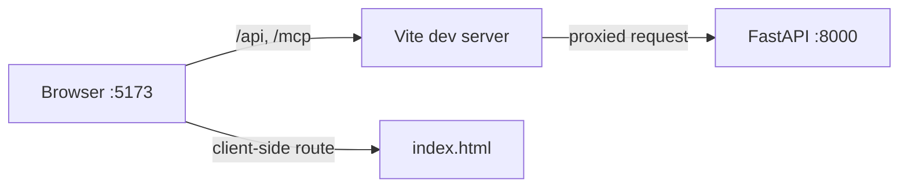

# Run the frontend

Serve the web UI against your local backend, and know what the Vite proxy does
for you.

*Diátaxis type: how-to* · **Audience:** frontend contributors · **Time:** 10 minutes

## Before you start

Node 20+, `pnpm`, and a backend on port 8000
([Run it locally](../getting-started/run-locally.md)).

## One origin in development



*Figure 1: The proxy keeps the browser on one origin, so no CORS preflight is needed. Only `/api` and `/mcp` are proxied; every other path is a client-side route the SPA resolves itself.*

Because the API lives below `/api`, a reload on `/iam/users` is simply the SPA
entry point: the dev server answers it with `index.html` and the browser then
requests `/api/iam/sessions/current`. Production behaves the same way — FastAPI
serves `dist/ui` and answers the same `/api` paths from the same origin, which is
also what a Databricks App does. The axios client reads `VITE_API_BASE`
(default `/api`), so a deployment can mount the API elsewhere at build time.

## Run it

```bash
cd frontend
pnpm install
pnpm dev
```

Open <http://localhost:5173>. To point at another backend:

```bash
VITE_BACKEND_URL=http://localhost:8080 pnpm dev
```

## Build and check

| Command | What it does |
|---|---|
| `pnpm typecheck` | `tsc --noEmit` |
| `pnpm lint` | ESLint flat config |
| `pnpm test` | Vitest component and unit tests |
| `pnpm build` | typecheck, then a production bundle in `../dist/ui` |
| `pnpm preview` | serve the built bundle |
| `pnpm e2e` | Playwright, with `pnpm e2e:reset` to reseed |

!!! warning "Component tests need explicit cleanup"
    The Vitest config has no globals, so Testing Library does not clean up
    automatically. A component suite must call `afterEach(cleanup)`, otherwise
    the second test sees the first test's DOM.

The bundle is written to `dist/ui` at the repository root — outside `frontend/`
— so it can ship as one artifact next to the Python package.

## FAQ

**Requests 404 through the proxy.** The prefix list in `frontend/vite.config.ts`
is explicit; a new backend prefix must be added there.

**I changed `VITE_BACKEND_URL` and nothing happened.** Restart `pnpm dev`; the
proxy target is read once at startup.

**Can I skip the frontend entirely?** Yes. Every UI action has an HTTP or MCP
equivalent; the UI is a client, not a layer.

## See also

- [HTTP API](../reference/http-api.md) — the routes the proxy forwards
- [Architecture](../concepts/architecture.md) — where the SPA sits
- `frontend/README.md` in the repository — frontend-specific conventions
