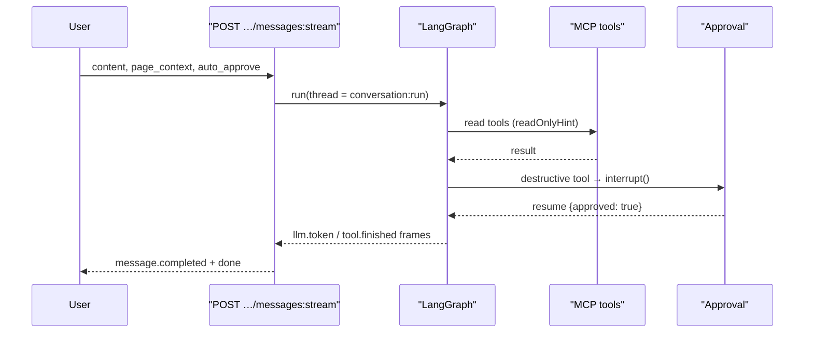

# Use the agent

Give the agent a model credential, ask a question about your metadata, and
answer the approval cards it raises before it writes anything.

*Diátaxis type: how-to* · **Audience:** users · **Time:** 20 minutes

## Before you start

A token ([First administrator and token](../getting-started/first-admin.md)), an
API key for an OpenAI-compatible model endpoint, and `agent-graph` plus
`agent-openai` installed (`uv sync --all-extras`).

## How a turn runs



*Figure 1: One turn, one checkpoint thread. The paused state lives in the database, so the answer may arrive from another process or hours later.*

## 1. Declare a provider

The config block is the only provider a file may describe; the lifecycle creates
it when it is missing and synchronises it on every start:

```yaml
agent:
  llm:
    name: deepseek
    kind: openai
    endpoint: https://api.deepseek.com
    credential_ref: env:DEEPSEEK_API_KEY
    default_model: deepseek-flash
    options:
      temperature: "0.0"
```

```bash
export DEEPSEEK_API_KEY=sk-…
uv run etla server
```

Further providers are created with `POST /agent/llm-providers`; a conversation
can pin one (`llm_provider_id`), otherwise the resolution walks **user default →
tenant default → system default → first public provider**.

## 2. Start a conversation and ask

```bash
CONV=$(curl -s -X POST http://localhost:8000/api/agent/conversations \
  -H "Authorization: Bearer $TOKEN" -H 'Content-Type: application/json' \
  -d '{"title": "catalog review"}' | sed -n 's/.*"conversation_id":"\([^"]*\)".*/\1/p')

curl -sN -X POST "http://localhost:8000/api/agent/conversations/$CONV/messages:stream" \
  -H "Authorization: Bearer $TOKEN" -H 'Content-Type: application/json' \
  -d '{"content": "Which tables have no description?", "page_context": "Data catalog"}'
```

The stream is SSE. `llm.reasoning` carries the model's thinking, `llm.token` the
answer, `tool.started`/`tool.finished` each call, and `message.completed` closes
the turn. The frame contract is in [SSE events](../reference/sse-events.md).

## 3. Answer an approval

A destructive tool (`discard_*`, `remove_*`, …) pauses the run:

```
event: approval.required
data: {"approval_id":"…","tool":"discard_table","args_hash":"…","reason":"…"}
```

```bash
curl -sN -X POST "http://localhost:8000/api/agent/runs/$RUN/approvals/$APPROVAL:stream" \
  -H "Authorization: Bearer $TOKEN" \
  -H 'Content-Type: application/json' -d '{"approved": true}'
```

The resume continues the same run and the same assistant message. One card is
pending at a time, even when the model asks for several destructive calls.

!!! warning "A paused run blocks the conversation"
    Until the approval is decided, a second message is rejected with `409`. After
    a page reload, `GET /agent/conversations/{id}/approvals` re-lists the card so
    you are never stuck.

## 4. Tune the guard rails

| Setting | Effect |
|---|---|
| `agent.tools.approval.default` | `deny` by default for a destructive tool that no rule mentions |
| `agent.tools.approval.rules` | first match wins (`match: "discard_*" → require_approval`) |
| `agent.tools.allowlist` / `denylist` | what the model may even see |
| `agent.limits.*` | tool calls, wall clock, token budget, output sizes |
| `auto_approve: true` | skips the *question*, never a `deny` rule |

`auto_approve` is a deliberate opt-out of the human gate; it does lift the
fallback `deny`, which is what a user who turned the switch on expects.

## FAQ

**Every turn ends with `(the model finished without an answer)`.** The provider
spent its budget thinking. Raise `max_tokens` in the provider options or use a
model that answers after reasoning.

**The model loops on the same tool.** It is fed a bracketed error
(`[not_found]`, `[conflict]`) and asked to correct itself; a wrong id usually
means the object was renamed — ids, not names, are the stable handle.

**Where do the tool previews come from?** Arguments are redacted against
`agent.tools.redact_argument_keys` before they are stored, so a preview never
contains a token.

## See also

- [Platform API](../reference/platform-api.md) — every route and body
- [Agent runtime](../concepts/agent-runtime.md) — graph, transport, checkpoints
- [Agent tools](../concepts/agent-tools.md) — policy, redaction, resource reads
