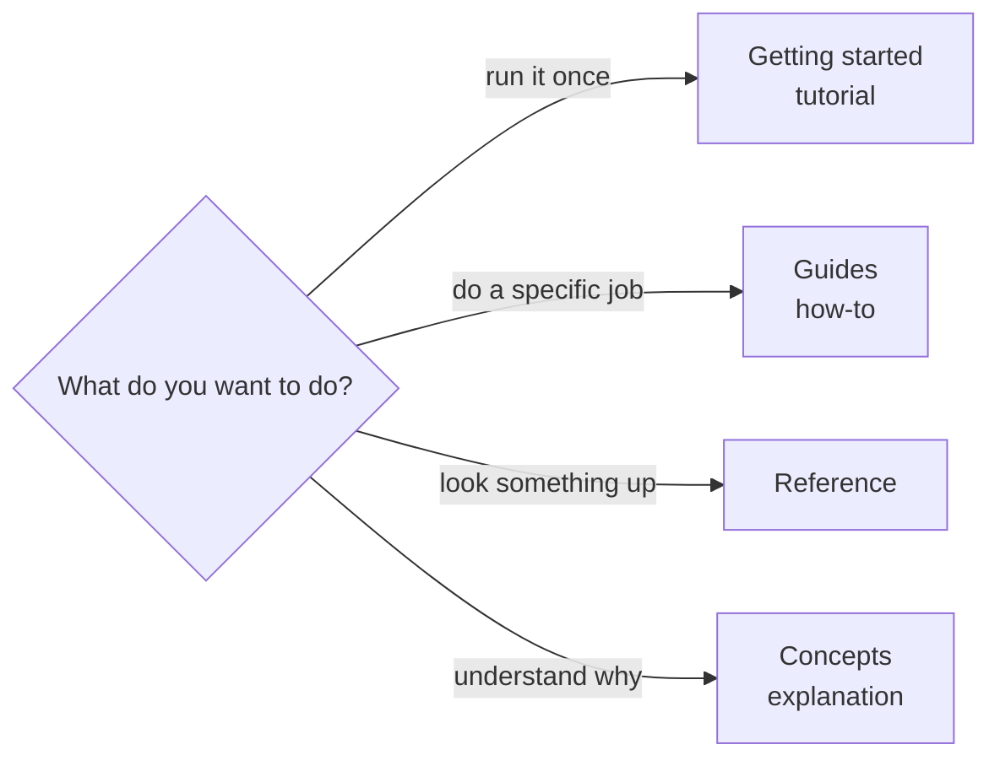
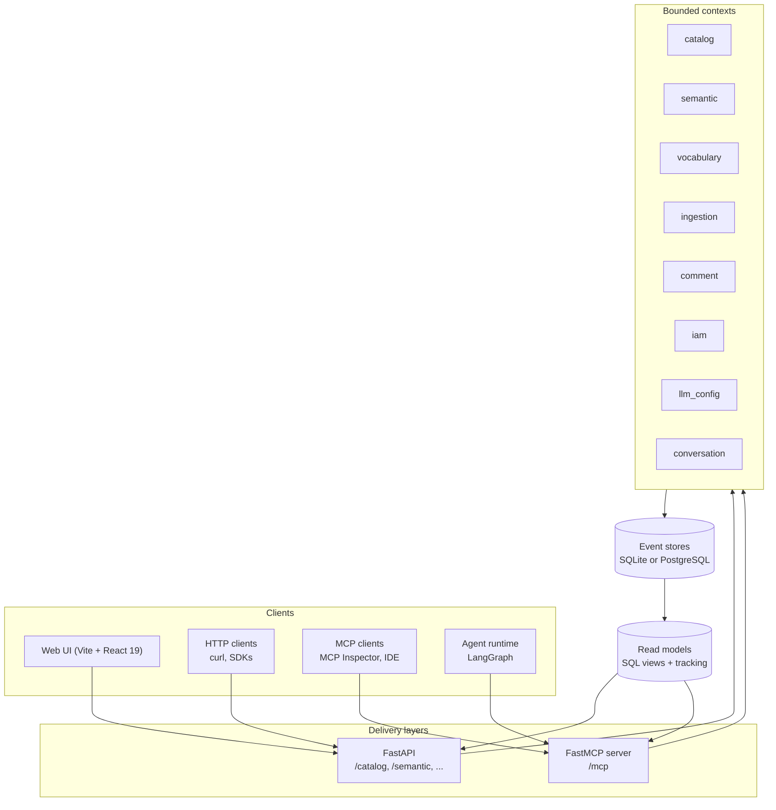

# ETLAlchemy

ETLAlchemy is an event-sourced metadata service that keeps one description of
your data estate — catalogs, schemas, tables, fields, semantic models, business
terms, comments and permissions — and serves it to people, to HTTP clients and
to an AI agent that can operate it for you.

*Diátaxis type: overview (landing page)* · **Audience:** everybody · **Prerequisites:** none

**On this page**

- [Where to start](#where-to-start)
- [The service in one picture](#the-service-in-one-picture)
- [The bounded contexts](#the-bounded-contexts)
- [Choose your path](#choose-your-path)
- [What is in the reference](#what-is-in-the-reference)
- [What is in concepts](#what-is-in-concepts)

## Where to start

*Figure 1: The four documentation paths. Pick the one that matches the question you are asking now; every page belongs to exactly one of them.*

The four directories are the four Diátaxis modes. A tutorial takes you by the
hand and always works; a how-to guide assumes you already have a working
install and solves one problem; reference pages are looked up, not read;
explanation pages answer "why is it built this way" and contain no steps.

## The service in one picture

*Figure 2: One set of use cases behind two delivery layers. Commands are recorded as events; reads are answered by the projection's tables, never by replaying the event stream.*

The two delivery layers share the application objects, so a tool, a route and a
test all execute the same use case. That is why the API surface and the MCP
surface stay in step even though they are written separately.

## The bounded contexts

| Context | The question it answers |
|---|---|
| `catalog` | Which catalogs, schemas, tables and fields exist, and what do they mean? |
| `semantic` | How do those tables relate, and how is a model laid out on a diagram? |
| `vocabulary` | Which business terms exist, how are they nested, and what do they link to? |
| `ingestion` | Which external sources may I read, and what did an import change? |
| `comment` | What have people said about an object? |
| `iam` | Who is authenticated, and what may they do? |
| `llm_config` | Which model endpoint and credential may a user spend? |
| `conversation` | What was asked, answered and approved in a chat session? |

Two more packages are not contexts: `etlalchemy/agent/` is the LLM runtime
(it holds no state) and `etlalchemy/app/` is the assembly layer (FastAPI,
FastMCP, the DI container and the CLI).

## Choose your path

| If you want to… | Start here |
|---|---|
| run the service for the first time | [Prerequisites](getting-started/prerequisites.md) |
| create the first administrator and a bearer token | [First administrator and token](getting-started/first-admin.md) |
| create a catalog, a schema, a table and a field | [Your first catalog](getting-started/first-catalog.md) |
| change ports, databases or logging | [Configure the service](guides/configure-settings.md) |
| let an IDE or an inspector call the tools | [Connect an MCP client](guides/connect-the-mcp-server.md) |
| copy a database's schema into a catalog | [Import a source database](guides/import-a-database.md) |
| talk to your metadata through a model | [Use the agent](guides/use-the-agent.md) |
| look up a route, a config key or an event | [Reference](#what-is-in-the-reference) |
| understand events, projections or the security model | [Concepts](#what-is-in-concepts) |

## What is in the reference

The reference is the authority for anything you copy and paste: the complete
configuration key list, every HTTP route and MCP primitive, the SSE frame
contract, the CLI subcommands, the physical table names and a glossary of the
domain words used everywhere else.

Start with [Configuration](reference/configuration.md) when a setting is not
doing what you expect, and with [HTTP API](reference/http-api.md) when a client
receives a status code you did not anticipate.

## What is in concepts

[Architecture](concepts/architecture.md) draws the package map;
[Event sourcing](concepts/event-sourcing.md) explains why commands are recorded
as facts and why the aggregate is the only place a rule lives;
[Read model](concepts/read-model.md) explains how a query is answered without
replay; [Security model](concepts/security.md) covers sessions, permissions and
encryption at rest; [Agent runtime](concepts/agent-runtime.md) explains the
LangGraph loop, tool policy and approvals.

## Repository map

| Path | Contents |
|---|---|
| `etlalchemy/<context>/` | One bounded context: aggregates, application, projection |
| `etlalchemy/shared/` | Infrastructure every context may reuse (logging, projection base, helpers) |
| `etlalchemy/app/` | Assembly only: bootstrap, config, API, MCP, CLI |
| `etlalchemy/agent/` | LangGraph runtime, MCP client, redaction, SSE |
| `frontend/` | Vite + React 19 single-page application |
| `tests/` | Tests grouped by context, mirroring `etlalchemy/` |
| `docker/` | PostgreSQL 18 compose file for local development |

## FAQ

**Is this the same as the API reference?** No. This page is a map; the
[HTTP API](reference/http-api.md) page lists the routes.

**Why are the docs in English?** They document the code, whose docstrings,
comments and error messages are English. The retired `README.md` was Chinese;
its content is fully represented here in English.

## See also

- [Prerequisites](getting-started/prerequisites.md) — install what the tutorial needs
- [Architecture](concepts/architecture.md) — the package map in detail
- [Glossary](reference/glossary.md) — every term used by this documentation
