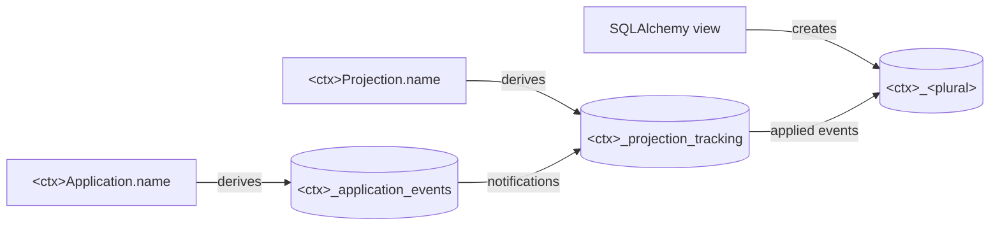
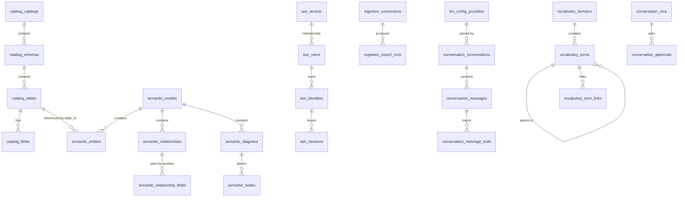

# Data store tables

Which physical tables the service creates, how they are named, and how they
relate.

*Diátaxis type: reference* · **Audience:** operators and contributors · **Prerequisites:** a running server

**On this page**

- [Three kinds of table](#three-kinds-of-table)
- [Naming rules](#naming-rules)
- [Catalog and knowledge](#catalog-and-knowledge)
- [Platform](#platform)
- [Relationships](#relationships)

## Three kinds of table

*Figure 1: The event store and the tracking table are derived from class names; the view tables are declared by the view. All three are snake_case, with no exceptions beyond the two LangGraph tables.*

## Naming rules

| Kind | Pattern | Example |
|---|---|---|
| Event store | `<context>_application_events` | `catalog_application_events` |
| Tracking | `<context>_projection_tracking` | `catalog_projection_tracking` |
| View tables | `<context>_<plural>` | `catalog_catalogs`, `iam_users` |
| Exception | LangGraph's own tables | `checkpoints`, `checkpoint_writes` |

Set `<Context>Application.name = "<context>_application"` and
`<Context>Projection.name = "<context>_projection"`; PostgreSQL derives the
event and tracking table names from them and SQLite uses the same names.
`ProjectionSettings.tracking_table_name` must match, so the route view and the
runner share one tracking table.

`tests/app/test_postgres_tables.py` asserts the generated names — add any new
context there.

## Catalog and knowledge

| Context | View tables |
|---|---|
| `catalog` | `catalog_catalogs`, `catalog_schemas`, `catalog_tables`, `catalog_fields` |
| `semantic` | `semantic_models`, `semantic_entities`, `semantic_relationships`, `semantic_relationship_fields`, `semantic_diagrams`, `semantic_nodes` |
| `vocabulary` | `vocabulary_domains`, `vocabulary_terms`, `vocabulary_term_aliases`, `vocabulary_term_links` |
| `comment` | `comment_threads`, `comment_comments`, `comment_mentions` |

Soft delete: `discarded_at` (nullable timestamp) on catalogs, schemas, tables,
connections and terms; every read filters `discarded_at IS NULL` and a
`register_*` upsert resets it. `catalog_fields` rows are deleted instead.

## Platform

| Context | View tables |
|---|---|
| `ingestion` | `ingestion_connections`, `ingestion_import_runs` |
| `iam` | `iam_tenants`, `iam_users`, `iam_tenant_members`, `iam_identities`, `iam_password_creds`, `iam_oidc_creds`, `iam_api_keys`, `iam_sessions`, `iam_groups`, `iam_group_members`, `iam_permission_grants`, `iam_auth_providers`, `iam_casbin_rules`, `iam_audit_log` |
| `llm_config` | `llm_config_providers` (+ `_shares`, `_defaults`) |
| `conversation` | `conversation_conversations`, `_messages`, `_message_resources`, `_message_tools`, `_runs`, `_approvals` |

Only the read model writes `iam_casbin_rules`; `CasbinAuthorizer` loads it into
an in-memory enforcer and rebuilds it when the policy generation changes.

## Relationships

*Figure 2: The read model's foreign-looking keys. They are plain columns — no database-level constraint — because an aggregate may be discarded independently; the application enforces the reference.*

`semantic_entities.table_id` points at `catalog_tables.table_id`, and
`vocabulary_term_links` points at catalog and semantic ids; both are resolved at
read time, which is why a dangling link is reported as `dangling` rather than
refused.

## See also

- [Read model](../concepts/read-model.md) — why these tables exist at all
- [Add a bounded context](../guides/add-a-bounded-context.md) — the naming checklist
- [Encrypt events at rest](../guides/enable-event-encryption.md) — what is encrypted
