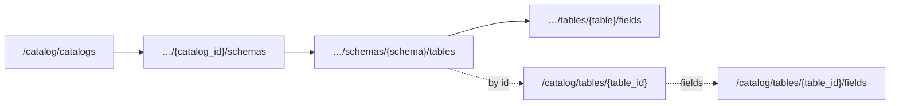

# HTTP API

The routes that read and write metadata: catalogs, semantic models, vocabulary
and comments.

*Diátaxis type: reference* · **Audience:** API consumers · **Prerequisites:** a running server

**On this page**

- [Conventions](#conventions)
- [Error mapping](#error-mapping)
- [Catalog](#catalog)
- [Semantic](#semantic)
- [Vocabulary](#vocabulary)
- [Comments](#comments)

## Conventions

| Prefix | Router module | Token required |
|---|---|---|
| `/catalog` | `app/api/routes/catalog.py` | no |
| `/semantic` | `app/api/routes/semantic.py` | no |
| `/vocabulary` | `app/api/routes/vocabulary.py` | no |
| `/comments` | `app/api/routes/comment.py` | yes |
| `/ingestion`, `/iam`, `/agent` | see [Platform API](platform-api.md) | `/iam`, `/agent`: yes |

OpenAPI is served at `/openapi.json` and Swagger UI at `/docs`.

**Name or id.** `{schema}` and `{table}` accept the registry name *or* the
`UUID`. A lookup tries the name first, then the id, and rejects an id that
belongs to another catalog or schema. Store ids: they survive a rename.

**Create answers from the aggregate.** A `POST` returns the new id instead of the
row, because the projection may not have applied the event yet.

**Delete is soft.** A `DELETE` answers `204`, sets `discarded_at` and cascades
to children; the name may be reused afterwards.

*Figure 1: One nesting chain plus two shortcut routes. `{schema}` and `{table}` accept a name or an id; the shortcut routes exist because a semantic entity stores only a table id.*

## Error mapping

| Status | Raised by | Example |
|---|---|---|
| `400` | `ValueError` in the aggregate or application | a colour that is not `#rrggbb`, an all-`None` patch |
| `404` | `Unknown*Error`, `AggregateNotFoundError` | a schema that does not exist |
| `409` | `Duplicate*Error`, `DiscardedError`, `RecordConflictError` | two concurrent writes to one stream |
| `422` | pydantic request validation | a body with neither credential |

The body is always `{"detail": "…"}`. `RecordConflictError` is optimistic
concurrency: retry the command after reloading the aggregate.

## Catalog

| Method | Path | Purpose |
|---|---|---|
| `POST` | `/catalog/catalogs?name=&description=` | create a catalog |
| `GET` | `/catalog/catalogs` | list catalogs |
| `GET` | `/catalog/catalogs/{catalog_id}` | one catalog |
| `PATCH` | `/catalog/catalogs/{catalog_id}` | change name or description |
| `DELETE` | `/catalog/catalogs/{catalog_id}` | discard a catalog |
| `POST` | `/catalog/catalogs/{catalog_id}/schemas?schema_name=&description=` | create a schema |
| `GET` | `/catalog/catalogs/{catalog_id}/schemas` | list schemas |
| `GET` | `/catalog/catalogs/{catalog_id}/schemas/{schema}` | one schema |
| `PATCH` | `/catalog/catalogs/{catalog_id}/schemas/{schema}` | change name or description |
| `DELETE` | `/catalog/catalogs/{catalog_id}/schemas/{schema}` | discard a schema |
| `POST` | `…/schemas/{schema}/tables?table_name=` | create a table |
| `GET` | `…/schemas/{schema}/tables` | list tables |
| `GET` | `…/schemas/{schema}/tables/{table}` | one table |
| `PATCH` | `…/schemas/{schema}/tables/{table}` | change name or description |
| `DELETE` | `…/schemas/{schema}/tables/{table}` | discard a table |
| `POST` | `…/tables/{table}/fields?field_name=&data_type=&nullable=` | add a field |
| `GET` | `…/tables/{table}/fields` | list fields |
| `PATCH` | `…/tables/{table}/fields/{field_name}` | change type, nullability or comment |
| `DELETE` | `…/tables/{table}/fields/{field_name}` | remove a field |
| `POST` | `…/fields/{field_name}/rename?new_name=` | rename a field |
| `GET` | `/catalog/tables/{table_id}` | a table plus its schema and catalog names |
| `GET` | `/catalog/tables/{table_id}/fields` | a table's fields, addressed by id |
| `GET` | `/catalog/search?term=` | search fields |
| `GET` | `/catalog/search-objects?term=` | search catalogs, schemas, tables, fields |

`data_type` is normalised (`VARCHAR(255)` → `varchar(255)`); an unknown or
wrongly parameterised type is a `400`. A field carries a `comment`; an empty
string clears it and an equal value records nothing.

## Semantic

A model is one aggregate: entities, relationships, diagrams and node positions.

| Method | Path | Purpose |
|---|---|---|
| `POST` | `/semantic/models` | create a model (also seeds the `All` diagram) |
| `GET` | `/semantic/models` | list models |
| `GET` | `/semantic/models/{model_id}` | one model |
| `PATCH` | `/semantic/models/{model_id}` | rename or describe |
| `DELETE` | `/semantic/models/{model_id}` | discard |
| `POST` | `/semantic/models/{model_id}/entities` | add an entity for a catalog table |
| `GET` | `/semantic/models/{model_id}/entities` | list entities |
| `GET` | `/semantic/models/{model_id}/entities/{entity_name}` | one entity |
| `PATCH` | `/semantic/models/{model_id}/entities/{entity_name}` | rename or re-point |
| `DELETE` | `/semantic/models/{model_id}/entities/{entity_name}` | remove (cascades) |
| `POST` | `/semantic/models/{model_id}/relationships` | add a relationship |
| `GET` | `/semantic/models/{model_id}/relationships` | list relationships |
| `GET` | `/semantic/models/{model_id}/relationships/{relationship_id}` | one relationship |
| `PATCH` | `/semantic/models/{model_id}/relationships/{relationship_id}` | change it |
| `DELETE` | `/semantic/models/{model_id}/relationships/{relationship_id}` | remove it |
| `POST` | `/semantic/models/{model_id}/diagrams` | add a diagram |
| `GET` | `/semantic/models/{model_id}/diagrams` | list diagrams |
| `GET` | `/semantic/models/{model_id}/diagrams/{name}` | one diagram |
| `PATCH` | `/semantic/models/{model_id}/diagrams/{name}` | rename it |
| `DELETE` | `/semantic/models/{model_id}/diagrams/{name}` | remove it (not `All`) |
| `POST` | `…/diagrams/{name}/nodes` | place an entity on a diagram |
| `GET` | `…/diagrams/{name}/nodes` | list nodes |
| `PATCH` | `…/diagrams/{name}/nodes/{entity_name}` | move a node |
| `DELETE` | `…/diagrams/{name}/nodes/{entity_name}` | remove a node |

`All` always shows every entity: it rejects `place`/`remove` and accepts `move`.
A relationship's `from_refs`/`to_refs` are `(entity, field)` pairs that pair up by
position, so the lengths must match. Removing an entity cascades to the
relationships and nodes that mention it; re-pointing an entity is a `409` while a
relationship references it.

## Vocabulary

Terms form a tree per domain, addressed by **id** in the URL (a path contains
`/`). `parent` and `path` travel in the body or query.

| Method | Path | Purpose |
|---|---|---|
| `POST` | `/vocabulary/domains` | create a domain |
| `GET` | `/vocabulary/domains` | list domains |
| `GET` | `/vocabulary/domains/{domain_id}` | one domain |
| `PATCH` | `/vocabulary/domains/{domain_id}` | rename or describe |
| `DELETE` | `/vocabulary/domains/{domain_id}` | discard with all terms |
| `POST` | `/vocabulary/domains/{domain_id}/terms` | create a term |
| `GET` | `/vocabulary/domains/{domain_id}/terms` | list the live tree |
| `GET` | `/vocabulary/domains/{domain_id}/children` | children of one term |
| `GET` | `…/terms/{term_id}` | one term |
| `PATCH` | `…/terms/{term_id}` | change definition, colour, aliases |
| `POST` | `…/terms/{term_id}/move` | reparent (and repath the subtree) |
| `DELETE` | `…/terms/{term_id}` | discard with descendants |
| `POST` | `…/terms/{term_id}/approve` | draft → approved |
| `POST` | `…/terms/{term_id}/reopen` | approved → draft |
| `POST` | `…/terms/{term_id}/deprecate` | → deprecated |
| `POST` | `…/terms/{term_id}/reactivate` | deprecated → approved |
| `POST` | `…/terms/{term_id}/links` | link to a catalog or semantic object |
| `DELETE` | `…/terms/{term_id}/links` | remove a link |
| `GET` | `…/terms/{term_id}/descendants` | the subtree |
| `GET` | `/vocabulary/terms-for-target` | terms that link to an object |
| `GET` | `/vocabulary/terms-for-table` | terms that link to a table |
| `GET` | `/vocabulary/terms-for-field` | terms that link to a column |
| `GET` | `/vocabulary/search?term=` | search terms |

A name may not be blank or contain `/`; a move that would create a cycle is a
`409`. Colour is metadata: `#abc` is expanded and lowercased, and a malformed
value is a `400`.

## Comments

A thread groups comments about one target. Every route here needs a bearer
token.

| Method | Path | Purpose |
|---|---|---|
| `POST` | `/comments/threads` | open a thread with a first comment |
| `GET` | `/comments/threads?target_type=&target_id=` | list threads |
| `GET` | `/comments/threads/{thread_id}` | one thread with its comments |
| `GET` | `/comments/threads/{thread_id}/comments` | paged comments |
| `POST` | `/comments/threads/{thread_id}/comments` | reply |
| `PATCH` | `/comments/threads/{thread_id}/comments/{comment_id}` | edit |
| `DELETE` | `/comments/threads/{thread_id}/comments/{comment_id}` | delete a comment |
| `POST` | `/comments/threads/{thread_id}/resolve` | mark resolved |
| `POST` | `/comments/threads/{thread_id}/reopen` | reopen |
| `DELETE` | `/comments/threads/{thread_id}` | discard the thread |
| `GET` | `/comments/targets/{target_type}/{target_id}` | resolve a target's name |
| `POST` | `/comments/targets/lookup` | resolve several targets at once |

Reads filter `author_tenant_id IS NULL OR = session tenant`. Comment depth is
derived at read time, never stored, so an edited tree needs no migration.

## See also

- [Platform API](platform-api.md) — ingestion, IAM and agent routes
- [Glossary](glossary.md) — the words used in these tables
- [MCP surface](mcp-surface.md) — the same operations as tools
