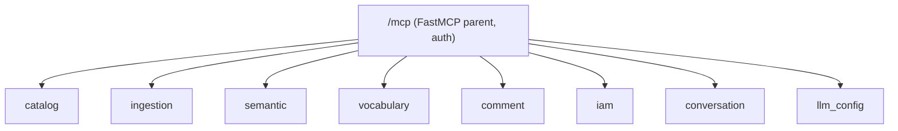

# MCP surface

Every tool, resource and prompt the MCP server exposes, and how the sub-servers
are mounted.

*Diátaxis type: reference* · **Audience:** tool builders · **Prerequisites:** a running server

**On this page**

- [One server, eight sub-servers](#one-server-eight-sub-servers)
- [Tools](#tools)
- [Resources](#resources)
- [Prompts](#prompts)
- [Errors and annotations](#errors-and-annotations)

## One server, eight sub-servers

*Figure 1: The parent enforces the token once; each mounted sub-server contributes its own primitives under bare names.*

A context is registered by decorating its `register(mcp, container)` in
`app/mcp/<context>/__init__.py` and importing that package in
`app/mcp/server.py`. A context that nobody imports is silently absent.

!!! warning "Mount without a namespace"
    With a namespace the tools are renamed (`catalog_create_catalog`), resource
    URIs gain a doubled slash (`catalog://catalog//all`) and prompts are
    prefixed. Mounted `instructions` never reach the client either, so the parent
    composes its summary from each context's `INSTRUCTIONS`.

**108 tools, 10 static resources, 25 templates and 15 prompts.** The exact sets
are asserted in `tests/app/mcp/test_tools_registered.py` and
`tests/app/mcp/test_resources_registered.py`, so this page cannot drift silently.

## Tools

Names are bare — there is no prefix.

| Context | Tools |
|---|---|
| catalog (18) | `create_catalog`, `change_catalog`, `change_catalog_description`, `discard_catalog`, `create_schema`, `change_schema`, `change_schema_description`, `discard_schema`, `add_table`, `change_table`, `change_table_description`, `discard_table`, `add_field`, `change_field`, `change_field_comment`, `remove_field`, `rename_field`, `search_fields` |
| ingestion (15) | `create_source_connection`, `change_source_connection`, `rotate_source_credential`, `discard_source_connection`, `import_source_catalog`, `list_source_connections`, `get_source_connection`, `list_source_kinds`, `list_source_profiles`, `inspect_source`, `plan_import`, `test_source_connection`, `list_import_runs`, `get_import_run`, `abandon_import_run` |
| semantic (26) | `create_model`, `change_model`, `discard_model`, `get_model`, `list_models`, `add_entity`, `rename_entity`, `change_entity_table`, `remove_entity`, `get_entity`, `list_entities`, `add_relationship`, `change_relationship`, `remove_relationship`, `get_relationship`, `list_relationships`, `add_diagram`, `rename_diagram`, `change_diagram_order`, `remove_diagram`, `get_diagram`, `list_diagrams`, `place_node`, `move_node`, `remove_node`, `list_nodes` |
| vocabulary (27) | `create_domain`, `change_domain`, `discard_domain`, `get_domain`, `list_domains`, `create_term`, `change_term_definition`, `change_term_color`, `rename_term`, `move_term`, `discard_term`, `get_term`, `list_terms`, `list_children`, `list_descendants`, `approve_term`, `reopen_term`, `deprecate_term`, `reactivate_term`, `add_term_alias`, `remove_term_alias`, `link_term`, `unlink_term`, `list_terms_for_target`, `list_terms_for_table`, `list_terms_for_field`, `search_terms` |
| comment (10) | `create_thread`, `add_comment`, `edit_comment`, `discard_comment`, `discard_thread`, `get_thread`, `list_threads`, `list_comments`, `resolve_thread`, `reopen_thread` |
| iam (8) | `get_user`, `list_users`, `list_tenants`, `list_groups`, `list_group_members`, `list_auth_providers`, `list_audit_events`, `list_api_keys` |
| conversation (2) | `list_conversations`, `list_conversation_messages` |
| llm_config (2) | `list_llm_providers`, `get_llm_provider` |

The IAM, conversation and llm_config contexts are exposed **read-only**: a tool
that could create an LLM provider could point it at an arbitrary endpoint, so
those writes stay on HTTP.

## Resources

Resources answer `application/json` text and return `null`/`[]` for an unknown
or malformed id instead of raising.

| Static | Template |
|---|---|
| `catalog:///all` | `catalog:///{catalog_id}` and its schema/table/field children |
| `ingestion:///connections`, `ingestion:///runs` | `ingestion:///connections/{connection_id}`, `ingestion:///runs/{run_id}` |
| `semantic:///models` | `semantic:///models/{model_id}` plus entities, relationships, diagrams, nodes |
| `vocabulary:///domains` | `vocabulary:///domains/{domain_id}`, `vocabulary:///terms/{term_id}` and its children/descendants |
| `iam:///tenants`, `iam:///users`, `iam:///providers`, `iam:///audit` | `iam:///users/{user_id}`, `iam:///groups/{tenant_id}` |
| `llm:///providers` | `llm:///{provider_id}` |
| — | `comment:///threads/{thread_id}`, `…/comments`, `comment:///targets/{target_type}/{target_id}/threads` |

A resource carries no caller identity, so `llm:///providers` lists **public**
providers only.

## Prompts

| Prompt | Use |
|---|---|
| `catalog-overview` | summarise what a catalog contains |
| `find-field` | locate a column by description |
| `inspect-table` | describe one table and its columns |
| `explain-table` | explain a table to a reader |
| `define-field` | draft a field comment |
| `review-vocabulary` | audit terms for gaps and duplicates |
| `model-from-catalog` | draft a semantic model from a catalog |
| `review-model` | review a model's entities and relationships |
| `iam-access-review` | review who can do what |
| `import-catalog-workflow` | plan and run an import |
| `open-thread-for-target` | start a discussion about an object |
| `draft-reply` | draft a reply in a thread |
| `review-thread` | summarise a thread |
| `resolve-discussion` | decide whether a thread is settled |
| `rename-safely` | rename without breaking links |

Prompts are English templates that point at resource URIs and never embed data;
their descriptions and rendered text must stay ASCII (a test enforces it).

## Errors and annotations

| Prefix | Meaning | Typical source |
|---|---|---|
| `[conflict]` | a domain rule rejected the input | duplicate name, discarded aggregate, bad colour |
| `[not_found]` | the object does not exist | unknown connection or run |
| `[internal]` | an unexpected failure | adapter crash |

FastMCP prefixes its own wrapper around the message. Every write tool and the
parameterised read tools carry `readOnlyHint`; `discard_*`, `remove_*`,
`abandon_import_run` and the other deletions carry `destructiveHint`, which is
what makes the agent pause for approval.

## See also

- [Connect an MCP client](../guides/connect-the-mcp-server.md) — wiring a client
- [Agent tools](../concepts/agent-tools.md) — how hints become approvals
- [HTTP API](http-api.md) — the same operations over HTTP
