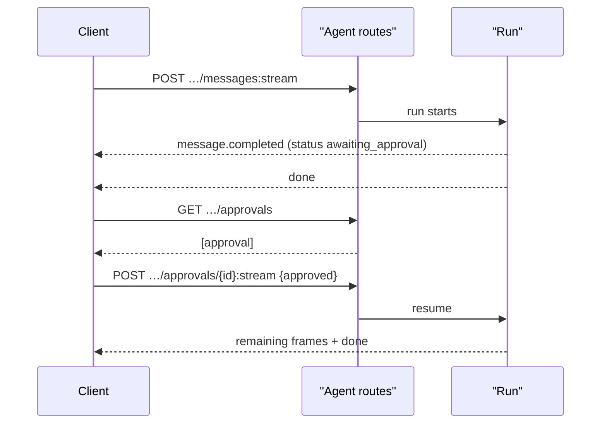

# Platform API

The routes that operate the platform: ingestion, IAM and the agent.

*Diátaxis type: reference* · **Audience:** API consumers · **Prerequisites:** a running server

**On this page**

- [Ingestion](#ingestion)
- [IAM](#iam)
- [Agent](#agent)
- [Authentication](#authentication)

## Ingestion

| Method | Path | Purpose |
|---|---|---|
| `POST` | `/ingestion/connections` | register a source connection (`201`) |
| `GET` | `/ingestion/connections` | list live connections |
| `GET` | `/ingestion/connections/{connection_id}` | one connection |
| `PATCH` | `/ingestion/connections/{connection_id}` | change endpoint, name, options |
| `POST` | `/ingestion/connections/{connection_id}/rotate` | rotate the credential |
| `DELETE` | `/ingestion/connections/{connection_id}` | discard (`204`) |
| `GET` | `/ingestion/source-kinds` | kinds this deployment registers |
| `GET` | `/ingestion/source-profiles` | local credential profiles |
| `GET` | `/ingestion/connections/{connection_id}/inspect?catalog=&schema=&table=&limit=` | walk the source tree |
| `POST` | `/ingestion/connections/{connection_id}/test` | probe the source |
| `POST` | `/ingestion/connections/{connection_id}/plan` | diff without writing |
| `POST` | `/ingestion/connections/{connection_id}/import` | run the import (synchronous) |
| `GET` | `/ingestion/runs` | import history |
| `GET` | `/ingestion/runs/{run_id}` | one run |

`POST /ingestion/connections` body:

```json
{
  "name": "warehouse",
  "kind": "postgres",
  "endpoint": "localhost:55432",
  "credential_ref": "env:SOURCE_PG_PASSWORD",
  "token": null,
  "default_catalog": null,
  "options": {"user": "etlalchemy", "database": "etlalchemy_test"}
}
```

Exactly one of `credential_ref` / `token`, otherwise `422`. `plan` and `import`
share the body: `target_catalog_id` (required), `source_catalog`,
`include_schemas`, `include_tables` (per source schema), `schema_mapping`. The
import is synchronous by design — there is no progress feed.

## IAM

Session, identity, tenancy and authorization routes. All of them require a
bearer token except `/auth/*`, `/bootstrap` and `/authorize` on a fresh install.

### Authentication

| Method | Path | Purpose |
|---|---|---|
| `POST` | `/iam/auth/token` | OAuth2 password form → `access_token` |
| `POST` | `/iam/auth/password` | JSON password login |
| `POST` | `/iam/auth/api-key` | exchange an API key for a session |
| `POST` | `/iam/auth/oidc` | exchange a verified `(issuer, subject)` |
| `POST` | `/iam/auth/refresh` | extend the current session |
| `POST` | `/iam/auth/logout` | revoke the session (`204`) |
| `GET` | `/iam/sessions/current` | the caller's session |
| `GET` | `/iam/bootstrap` | is a system administrator configured |
| `POST` | `/iam/authorize` | evaluate a permission for the caller |

`/iam/auth/token` takes `application/x-www-form-urlencoded` (`username`,
`password`, optional `scope=tenant:<uuid>`). Every response carries an opaque
`access_token` (`iam_sess_<session_id>`), `expires_at` and `refresh_at`.

### Tenants and users

| Method | Path | Purpose |
|---|---|---|
| `POST` | `/iam/tenants` | create (`201`) |
| `GET` | `/iam/tenants` | list |
| `PATCH` | `/iam/tenants/{tenant_id}` | rename (`204`) |
| `DELETE` | `/iam/tenants/{tenant_id}` | discard, cascading sessions and rules |
| `GET` | `/iam/tenants/{tenant_id}/members` | members |
| `POST` | `/iam/tenants/{tenant_id}/members` | add a member (`204`) |
| `DELETE` | `/iam/tenants/{tenant_id}/members/{user_id}` | remove a member |
| `POST` | `/iam/users` | create a user (`201`) |
| `GET` | `/iam/users` | list |
| `GET` | `/iam/users/search?term=` | search |
| `GET` | `/iam/users/{user_id}` | one user |
| `PATCH` | `/iam/users/{user_id}` | change profile |
| `DELETE` | `/iam/users/{user_id}` | discard |
| `POST` | `/iam/users/{user_id}/system-admin` | grant the flag |
| `DELETE` | `/iam/users/{user_id}/system-admin` | revoke the flag |

### Identities and credentials

| Method | Path | Purpose |
|---|---|---|
| `POST` | `/iam/users/{user_id}/identities/password` | attach a password (`201`) |
| `POST` | `/iam/users/{user_id}/identities/oidc` | attach an OIDC subject (`201`) |
| `GET` | `/iam/users/{user_id}/identities` | list identities |
| `PATCH` | `/iam/identities/{identity_id}` | change it (`204`) |
| `DELETE` | `/iam/identities/{identity_id}` | remove it |
| `POST` | `/iam/passwords/change` | change own password |
| `POST` | `/iam/passwords/reset` | reset someone's password |
| `POST` | `/iam/users/{user_id}/api-keys` | issue a key (`201`) |
| `GET` | `/iam/users/{user_id}/api-keys` | list keys |
| `POST` | `/iam/users/{user_id}/api-keys/{key_id}/rotate` | rotate (`201`) |
| `DELETE` | `/iam/users/{user_id}/api-keys/{key_id}` | revoke |

A credential change increments `Identity.credential_version`, which invalidates
sessions issued before it.

### Groups and permissions

| Method | Path | Purpose |
|---|---|---|
| `POST` | `/iam/tenants/{tenant_id}/groups` | create a group (`201`) |
| `GET` | `/iam/tenants/{tenant_id}/groups` | list groups |
| `PATCH` | `/iam/groups/{group_id}` | rename (`204`) |
| `POST` | `/iam/groups/{group_id}/parent` | re-parent (cycle-safe) |
| `DELETE` | `/iam/groups/{group_id}` | discard |
| `GET` | `/iam/groups/{group_id}/members` | members |
| `POST` | `/iam/groups/{group_id}/members` | add a member |
| `DELETE` | `/iam/groups/{group_id}/members/{member_id}` | remove a member |
| `POST` | `/iam/tenants/{tenant_id}/groups/{group_id}/permissions` | grant |
| `DELETE` | `/iam/tenants/{tenant_id}/groups/{group_id}/permissions` | revoke |
| `POST` | `/iam/providers` | create an auth provider (`201`) |
| `GET` | `/iam/providers` | list providers |
| `PATCH` | `/iam/providers/{provider_id}` | change configuration |
| `DELETE` | `/iam/providers/{provider_id}` | discard |
| `GET` | `/iam/audit` | audit log |

## Agent

| Method | Path | Purpose |
|---|---|---|
| `GET` | `/agent/llm-providers` | providers visible to the caller |
| `POST` | `/agent/llm-providers` | create one |
| `GET` | `/agent/llm-providers/{provider_id}` | detail |
| `PATCH` | `/agent/llm-providers/{provider_id}` | change endpoint, model, options |
| `POST` | `/agent/llm-providers/{provider_id}/rotate` | rotate its credential |
| `POST` | `/agent/llm-providers/{provider_id}/share` | share with users or groups |
| `POST` | `/agent/llm-providers/{provider_id}/default` | make it a default |
| `DELETE` | `/agent/llm-providers/{provider_id}` | discard |
| `GET` | `/agent/conversations` | the caller's conversations |
| `POST` | `/agent/conversations` | start one (`201`) |
| `GET` | `/agent/conversations/{conversation_id}` | one conversation |
| `PATCH` | `/agent/conversations/{conversation_id}` | title or pinned provider |
| `DELETE` | `/agent/conversations/{conversation_id}` | discard |
| `GET` | `/agent/conversations/{conversation_id}/messages` | transcript |
| `GET` | `/agent/conversations/{conversation_id}/approvals` | pending approvals |
| `GET` | `/agent/runs/{run_id}` | run status and trace |
| `POST` | `/agent/conversations/{conversation_id}/messages` | one synchronous turn |
| `POST` | `/agent/conversations/{conversation_id}/messages:stream` | one streamed turn (SSE) |
| `POST` | `/agent/conversations/{conversation_id}/messages/{message_id}/edit:stream` | edit and re-run |
| `POST` | `/agent/runs/{run_id}/approvals/{approval_id}:stream` | decide and resume (SSE) |

The streaming body carries `content`, optional `llm_provider_id` and
`page_context`, and `auto_approve`. `page_context` is spliced into the system
prompt of that run only: it is never stored with the message and never replayed.
The frame contract is in [SSE events](sse-events.md).



*Figure 1: A paused run closes its stream cleanly, so a client that reloaded can rebuild the card from the approvals route and resume the same assistant message.*

## Authentication

The token travels in `Authorization: Bearer <token>` only. The session id is
never accepted in a body, a query string or a path. Every rejection is the same
`401` with `WWW-Authenticate: Bearer` and the detail `invalid or expired token`,
so a client cannot enumerate sessions.

## See also

- [HTTP API](http-api.md) — catalog, semantic, vocabulary and comment routes
- [SSE events](sse-events.md) — the frames the agent streams
- [Security model](../concepts/security.md) — sessions, permissions, audit
