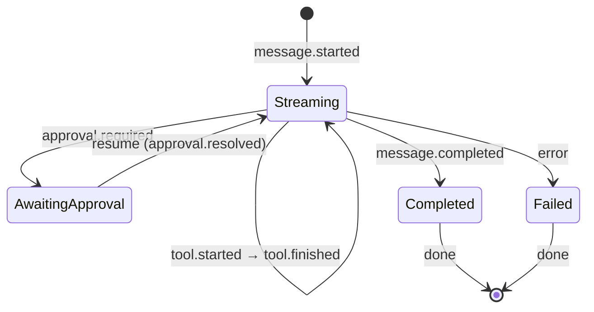

# SSE events

The frame contract of the two streaming endpoints.

*Diátaxis type: reference* · **Audience:** client developers · **Prerequisites:** an agent conversation

**On this page**

- [Endpoints and frames](#endpoints-and-frames)
- [Request body](#request-body)
- [Event types](#event-types)
- [Thinking and tool previews](#thinking-and-tool-previews)
- [Reconnection](#reconnection)
- [Approvals over the stream](#approvals-over-the-stream)

## Endpoints and frames

`POST /agent/conversations/{id}/messages:stream` and
`POST /agent/runs/{run_id}/approvals/{approval_id}:stream` answer
`text/event-stream`.

```
id: 3
event: tool.started
data: {"run_id":"…","message_id":"…","seq":3,"timestamp":"…","tool":"list_models","args_hash":"…"}
```

- `id` is the `seq`, monotonic within one run and starting at `1`;
- `data` always carries `run_id`, `message_id`, `seq` and `timestamp`, with the
  event payload merged in;
- `: ping` is sent after 15 idle seconds.

## Request body

| Field | Type | Meaning |
|---|---|---|
| `content` | str | the user prompt |
| `llm_provider_id` | UUID? | pin a provider for this run |
| `auto_approve` | bool | never pause for approval (a `deny` rule still denies) |
| `page_context` | str? | where the reader is, spliced into this run's system prompt |

`page_context` is capped at 2000 characters, is never stored with the message
and never appears in the transcript, so an identical prompt from another page
starts clean.

## Event types

| Event | Payload |
|---|---|
| `message.started` | `message_id` |
| `llm.reasoning` | `delta` |
| `llm.token` | `delta` |
| `tool.started` | `tool`, `args_hash`, `args_json` |
| `tool.finished` | `tool`, `args_hash`, `status`, `duration_ms`, `error_code`, `args_json`, `result_preview` |
| `resource.read` | `uri`, `size_bytes`, `mime_type` |
| `approval.required` | `approval_id`, `tool`, `args_hash`, `reason` |
| `approval.resolved` | `approval_id`, `approved` |
| `message.completed` | `status`, `final_answer`, `reasoning`, `tools_called`, `resources_accessed`, `token_usage`, `approvals` |
| `error` | `message` |
| `done` | `status` |

`message.completed` and the persisted assistant message are built from the same
trace lists, so a client that stores the event can replay the history offline.



*Figure 1: Stream states. A pause is a normal end of stream — `message.completed` with `status: awaiting_approval` and then `done` — not a dropped connection.*

A resource read is a tool call: `read_mcp_resource` emits `tool.started` and
`tool.finished` around the `resource.read` frame, so the step list holds one
card per read and the trace survives a reload.

## Thinking and tool previews

`llm.reasoning` streams the model's thinking before its answer, when the
provider emits any (DeepSeek sends `reasoning_content`, Anthropic-style models
send `reasoning` content blocks). The full text is repeated on
`message.completed` and stored with the message, so a client that missed frames
can still fill it in.

`args_json` and `result_preview` are **previews**: arguments are redacted against
`agent.tools.redact_argument_keys` and truncated to `max_tool_args_chars`; the
result is truncated to `max_tool_result_preview_chars`, while the model reads up
to `max_tool_output_chars`. `GET …/messages` answers the same fields, so the
detail panel survives a reload. `args_hash` stays the provenance of the exact
payload that was sent.

## Reconnection

Send `Last-Event-ID: <seq>`; the server replays every buffered event with a
higher `seq` before subscribing to new ones. The buffer holds the last 1000
events **of the process that ran the stream**, so a reconnect to another replica
falls back to `GET /agent/conversations/{id}/messages`.

## Approvals over the stream

When a run pauses, the stream ends with `message.completed`
(`status: awaiting_approval`) followed by `done`, so a client that waits for the
stream to close is never left hanging. The `approvals` list in the payload is the
whole run.

Post the decision to `/api/agent/runs/{run_id}/approvals/{approval_id}:stream`; it
continues the same run **and the same assistant message**.

`approval.resolved` is emitted on the stream that applies a decision, including
the resume that follows it, even when the decision was recorded by the request
that started the stream. A client uses it to settle the card; a stream that
skipped it would leave the card pending until the next reload.

An `approval_id` is derived from `(run_id, tool, args_hash)` plus the
occurrence of a repeated identical call, so a resumed run re-asks with the id the
client already knows and the server never emits a second `approval.required` for
it. A turn with several destructive calls pauses once per call, in call order:
`message.completed` lists the approval that is pending now, and deciding it
streams the next `approval.required`.

Answering a card whose decision is already recorded (a second tab, or a click the
resume won) answers `409` `approval <id> is already approved|denied`; the client
drops the card and re-reads the run instead of showing an error.

## See also

- [Platform API](platform-api.md) — the agent routes that produce these frames
- [Agent tools](../concepts/agent-tools.md) — policy, redaction, resource reads
- [Use the agent](../guides/use-the-agent.md) — the same flow by hand
